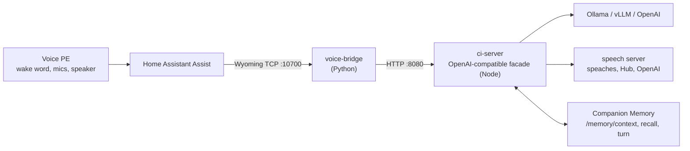

# CI-Home-Assistant-Voice-PE

**Companion Voice for Home Assistant.** Connects the
[Home Assistant Voice Preview Edition](https://www.home-assistant.io/voice-pe/)
to a self-hosted Companion: a local LLM through Ollama, local or cloud speech,
and your [Companion Memory](https://github.com/companionintelligence/CI-Server).

Setup guide and config generator: **https://ha.ci.computer** (source in [`web/`](web/)).



The bridge is a [Wyoming](https://github.com/rhasspy/wyoming) server. Home
Assistant's Wyoming Protocol integration turns it into three entities, which
together make a full Assist pipeline:

| Wyoming service | Program name | Home Assistant entity | ci-server call |
|---|---|---|---|
| `asr` | `companion-stt` | Speech-to-text | `POST /v1/audio/transcriptions` |
| `handle` | `companion-conversation` | Conversation agent | `POST /v1/responses` |
| `tts` | `companion-tts` | Text-to-speech | `POST /v1/audio/speech` |

You can use all three, or keep Home Assistant's own Whisper and Piper add-ons
for speech and use only `companion-conversation`.

## Repository layout

```
ci-server/        OpenAI-compatible facade (TypeScript / Express)
  src/memory/       Companion Memory client: recall before, save after each turn
  src/providers/    LLM routing (Ollama, vLLM, OpenAI) and STT/TTS routing
  src/routes/       /v1/models, chat, responses, audio, speech, status
  tests/            Jest tests with in-process stub upstreams
voice-bridge/     Wyoming server for Home Assistant (Python / asyncio)
  src/wyoming/      event handler and service description
  src/client/       ci-server HTTP client
  tests/            unit tests and Wyoming end-to-end tests
e2e/              whole-stack test: real ci-server + real bridge, stubbed upstreams
web/              ha.ci.computer, a Cloudflare Worker serving static assets
db/migrations/    PostgreSQL schema (reserved for multi-tenant keys)
docker-compose.yml  full stack for development
scripts/test-all.sh every check, the way CI runs it
```

## Quick start

The easiest path is the generator at https://ha.ci.computer. It builds a `.env`
in your browser and serves a `compose.yml` that pulls published images.

From a checkout:

```bash
cp .env.example .env        # set MASTER_API_KEY and POSTGRES_PASSWORD
docker compose up -d
docker compose exec ollama ollama pull llama3.2
```

For fully local speech, add the speaches container and download its models once:

```bash
docker compose --profile local-audio up -d
curl -X POST http://localhost:8000/v1/models/Systran/faster-distil-whisper-small.en
curl -X POST http://localhost:8000/v1/models/speaches-ai/Kokoro-82M-v1.0-ONNX
```

and set `STT_BASE_URL`, `STT_MODEL`, `TTS_BASE_URL`, `TTS_MODEL` and
`CI_TTS_VOICE` as shown in `.env.example`.

| Service | Port | What it is |
|---|---|---|
| voice-bridge | 10700 (TCP) | Wyoming server Home Assistant connects to |
| ci-server | 8080 | OpenAI-compatible API |
| ollama | 11434 | Local LLM |
| speaches | 8000 | Local STT and TTS (`--profile local-audio`) |
| postgres | internal | Reserved for tenant keys and history |
| redis | internal | Reserved for stream cache and quotas |

### Connect Home Assistant

1. **Settings, Devices & services, Add integration, Wyoming Protocol.**
2. Host: the machine running the stack. Port: `10700`.
3. **Settings, Voice assistants**, add an assistant. Choose
   `companion-conversation` as the conversation agent, and either the
   companion or your existing speech engines.
4. On the Voice PE device page, set **Assistant** to it.

Set `WYOMING_ZEROCONF=true` (with host networking) to have Home Assistant
discover the bridge on its own.

### Connect Companion Memory

Create an API key in Companion Memory under **Settings, API keys** with only the
`memory` scope, then set:

```bash
CI_MEMORY_URL=https://<your-companion-memory>/api
CI_MEMORY_API_KEY=<key>
```

Before each answer ci-server fetches `GET /memory/context` and
`POST /memory/recall` (within `CI_MEMORY_TIMEOUT_MS`, default 1500 ms) and adds
them as a system message marked as reference data. After the answer it saves the
exchange with `POST /memory/turn` (`platform: ha-voice-pe`, `sessionId` from
Home Assistant's conversation id). Set `CI_MEMORY_SAVE_TURNS=false` to recall
without saving. If memory is slow or down, the assistant still answers.

### Run under Companion Hub

Install **Home Assistant Voice** (`ci-ha-voice`, listed in CI-Marketplace) from
the Hub store. Hub wires it up without a `.env`:

- **Model**: Hub injects `CI_LLM_BASE_URL`, `CI_LLM_API_KEY` and `CI_CHAT_MODEL`
  for its inference pool; ci-server uses them when `OLLAMA_BASE_URL` and
  `CI_MODEL` are unset.
- **Memory**: Hub's connect flow mints a Companion Memory key limited to the
  `memory` scope and injects `CI_MEMORY_URL` and `CI_MEMORY_API_KEY`.
- **Speech**: keep Home Assistant's own Whisper and Piper, or set `STT_BASE_URL`
  and `TTS_BASE_URL` to `http://ci-hub:5002/api/inference` to use Hub's engines
  (needs Hub with multipart transcription, companionintelligence/CI-Hub#1643).

## API

Every `/v1` endpoint requires `Authorization: Bearer <MASTER_API_KEY>`, in every
environment. With `MASTER_API_KEY` unset, ci-server refuses `/v1` requests with
`503 auth_not_configured`. The key is compared in constant time.

| Method | Path | Notes |
|---|---|---|
| `GET` | `/health` | Unauthenticated liveness |
| `GET` | `/v1/status` | Which LLM, STT, TTS and memory providers are wired up and reachable. No secrets. |
| `GET` | `/v1/models` | From Ollama |
| `POST` | `/v1/chat/completions` | Streaming SSE supported; grounded in memory when configured |
| `POST` | `/v1/responses` | Typed SSE events; `metadata.session_id` groups saved turns |
| `POST` | `/v1/audio/transcriptions` | Multipart; routed to `STT_BASE_URL`, else OpenAI Whisper, else `503 stt_not_configured` |
| `POST` | `/v1/audio/speech` | `response_format` (or legacy `format`); routed to `TTS_BASE_URL`, else OpenAI, else `503 tts_not_configured` |

Local speech servers accept any voice name (`af_heart`, `en_US-lessac-medium`);
OpenAI routing accepts only OpenAI voices.

```bash
curl http://localhost:8080/v1/status -H "Authorization: Bearer $MASTER_API_KEY"
```

## Configuration

`.env.example` documents every variable. The main ones:

| Variable | Default | Used by |
|---|---|---|
| `MASTER_API_KEY` | required | ci-server; the bridge sends it as `CI_SERVER_API_KEY` |
| `CI_MODEL` | `ollama:llama3.2` | both |
| `OLLAMA_BASE_URL` | `http://ollama:11434` | ci-server |
| `STT_BASE_URL`, `STT_MODEL`, `STT_API_KEY` | empty | ci-server |
| `TTS_BASE_URL`, `TTS_MODEL`, `TTS_API_KEY` | empty | ci-server |
| `OPENAI_API_KEY` | empty | ci-server fallback for speech and `openai:` models |
| `CI_MEMORY_URL`, `CI_MEMORY_API_KEY` | empty | ci-server |
| `CI_MEMORY_RECALL`, `CI_MEMORY_SAVE_TURNS` | `true` | ci-server |
| `CI_TTS_VOICE`, `CI_TTS_VOICES` | `alloy` | bridge (voices offered to Home Assistant) |
| `LANGUAGES` | `en` | bridge |
| `SYSTEM_INSTRUCTIONS` | concise assistant | bridge |
| `HISTORY_TURNS`, `HISTORY_TTL_S` | `6`, `300` | bridge (follow-up context) |
| `WYOMING_ZEROCONF` | `false` | bridge |
| `CORS_ORIGINS` | `*` | ci-server (the ha.ci.computer checker needs it) |

## Development and testing

```bash
scripts/test-all.sh   # everything below, in order
```

```bash
cd ci-server && npm ci && npm run typecheck && npm test && npm run build
cd voice-bridge && pip install -r requirements.txt -r requirements-dev.txt && python -m pytest
python -m pytest e2e          # needs ci-server/dist from npm run build
cd web && npm ci && npm test && npm run check
```

- **ci-server**: Jest with local stub servers for Ollama, speaches and Companion
  Memory (`tests/helpers.ts`), so no network is needed.
- **voice-bridge**: pytest; `tests/test_bridge_e2e.py` drives the bridge with the
  real `wyoming` client against a fake ci-server.
- **e2e**: launches the built ci-server and the bridge as processes and runs
  describe, speech-to-text, a memory-grounded conversation and text-to-speech,
  then checks what reached each upstream.
- **web**: `node --test` for the generator logic, plus a drift test that keeps
  `web/public/compose.yml` in step with `docker-compose.yml`.

GitHub Actions runs are gated, as in the rest of the organization. Dispatch
`ci.yml` by hand when you want a hosted run:

```bash
gh workflow run ci.yml --repo companionintelligence/CI-Home-Assistant-Voice-PE --ref <branch>
```

## Deployment

- **ha.ci.computer**: `.github/workflows/deploy-web.yml` deploys `web/` as the
  Worker `ci-ha-voice-setup` with a Custom Domain whenever `web/` changes on
  `main`. It needs the `CLOUDFLARE_API_TOKEN` and `CLOUDFLARE_ACCOUNT_ID`
  secrets, and `ha.ci.computer` must not already have a DNS record. Manual
  deploy: `cd web && npx wrangler deploy`.
- **Images**: `.github/workflows/publish-images.yml` publishes
  `ghcr.io/companionintelligence/ci-ha-voice-server` and `ci-ha-voice-bridge`
  (amd64 and arm64) on `v*` tags or on demand. Make both packages public after
  the first run so `compose.yml` and Companion Hub can pull them.

## License

[PolyForm Noncommercial 1.0.0](LICENSE.md). See [NOTICE.md](NOTICE.md),
[THIRD_PARTY.md](THIRD_PARTY.md) and [CREDITS.md](CREDITS.md).
