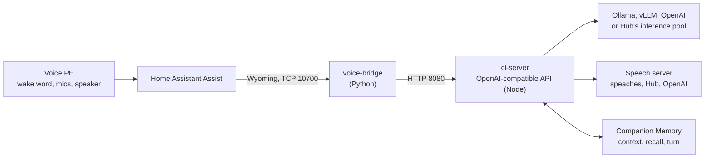

<div align="center">


# Companion Voice for Home Assistant

**Your Voice PE, answered by a Companion that runs on your hardware and remembers what matters to you.**

[Setup guide](https://ha.ci.computer) ·
[Docs](https://docs.ci.computer/docs/apps-available/first-party-apps/home-assistant-voice-pe) ·
[Companion Hub](https://ci.computer/hub) ·
[Voice PE hardware](https://www.home-assistant.io/voice-pe/)

</div>

---

Companion Voice connects the [Home Assistant Voice Preview Edition](https://www.home-assistant.io/voice-pe/)
to your own Companion Intelligence stack. Say the wake word and the answer comes
from a local model, grounded in your [Companion Memory](https://github.com/companionintelligence/CI-Server),
with every word staying in your home.

- **Works with the Home Assistant you have.** The voice path plugs into Assist through the standard Wyoming integration and needs no custom component. See [how the pieces fit](docs/architecture.md).
- **Local by default.** Answers from Ollama (or any OpenAI-compatible model), speech from Home Assistant's own Whisper and Piper, or from Companion's.
- **Remembers.** With a memory-scoped key, each answer draws on what your Companion knows, and each exchange is saved back as a conversation.
- **Fifteen-minute setup.** The guided page at [ha.ci.computer](https://ha.ci.computer) writes your config, links straight into Home Assistant, and checks the result.

## Choose your path

| Path | Best for | What you do |
|---|---|---|
| **Companion Hub** | You already run Hub | Install **Home Assistant Voice** from the store. Hub supplies the model and connects memory. |
| **Docker** | Any Mac, PC or Linux box | Download `compose.yml` and a generated `.env` from [ha.ci.computer](https://ha.ci.computer), then `docker compose up -d`. |
| **From source** | Development | Clone this repo and use `docker-compose.yml`, below. |

Whichever you pick, finish in Home Assistant:

1. [Add the Wyoming Protocol integration](https://my.home-assistant.io/redirect/config_flow_start/?domain=wyoming) with the host's address and port `10700`.
2. In [Voice assistants](https://my.home-assistant.io/redirect/voice_assistants/), add an assistant with `companion-conversation` as its conversation agent.
3. On the Voice PE's device page, set **Assistant** to it and ask it something only your Companion would know.

## How it works



The bridge is a [Wyoming](https://github.com/rhasspy/wyoming) server. Home Assistant
turns its three services into entities that make up a full Assist pipeline:

| Wyoming service | Program | In Home Assistant | ci-server call |
|---|---|---|---|
| `handle` | `companion-conversation` | Conversation agent | `POST /v1/responses` |
| `asr` | `companion-stt` | Speech-to-text | `POST /v1/audio/transcriptions` |
| `tts` | `companion-tts` | Text-to-speech | `POST /v1/audio/speech` |

The simplest setup uses only `companion-conversation` and keeps Home Assistant's
faster-whisper and Piper add-ons for speech.

## Quick start from source

```bash
git clone https://github.com/companionintelligence/CI-Home-Assistant-Voice-PE.git
cd CI-Home-Assistant-Voice-PE
cp .env.example .env          # set MASTER_API_KEY and POSTGRES_PASSWORD (openssl rand -hex 32)
docker compose up -d
docker compose exec ollama ollama pull llama3.2
curl http://localhost:8080/v1/status -H "Authorization: Bearer $MASTER_API_KEY"
```

For fully local speech, start the speaches container too and download its models once:

```bash
docker compose --profile local-audio up -d
curl -X POST http://localhost:8000/v1/models/Systran/faster-distil-whisper-small.en
curl -X POST http://localhost:8000/v1/models/speaches-ai/Kokoro-82M-v1.0-ONNX
```

then set `STT_BASE_URL`, `STT_MODEL`, `TTS_BASE_URL`, `TTS_MODEL` and `CI_TTS_VOICE`
as shown in `.env.example`.

| Service | Port | What it is |
|---|---|---|
| voice-bridge | 10700 (TCP) | Wyoming server Home Assistant connects to |
| ci-server | 8080 | OpenAI-compatible API |
| ollama | 11434 | Local LLM |
| speaches | 8000 | Local STT and TTS (`--profile local-audio`) |
| postgres, redis | internal | Reserved for tenant keys and history |

Set `WYOMING_ZEROCONF=true` (with host networking) and Home Assistant discovers the bridge by itself.

## Companion Memory

Create an API key in Companion Memory under **Settings, API keys** with only the
`memory` scope (under Hub, the connect flow does this for you), then set:

```bash
CI_MEMORY_URL=https://<your-companion-memory>/api
CI_MEMORY_API_KEY=<key>
```

Before each answer ci-server fetches `GET /memory/context` and `POST /memory/recall`
(within `CI_MEMORY_TIMEOUT_MS`, default 1500 ms) and adds them as a system message
marked as reference data. After the answer it saves the exchange with
`POST /memory/turn` (`platform: ha-voice-pe`, `sessionId` from Home Assistant's
conversation id). `CI_MEMORY_SAVE_TURNS=false` recalls without saving. If memory is
slow or down, the assistant still answers.

## Running under Companion Hub

The Hub listing (`ci-ha-voice` in CI-Marketplace) needs no `.env`:

- **Model:** Hub injects `CI_LLM_BASE_URL`, `CI_LLM_API_KEY` and `CI_CHAT_MODEL`; ci-server uses them when `OLLAMA_BASE_URL` and `CI_MODEL` are unset.
- **Memory:** Hub's connect flow mints a key limited to the `memory` scope and injects `CI_MEMORY_URL` and `CI_MEMORY_API_KEY`.
- **Speech:** keep Home Assistant's Whisper and Piper, or set the speech server to `http://ci-hub:5002/api/inference` to use Hub's engines.

## Configuration

`.env.example` documents every variable. The main ones:

| Variable | Default | Used by |
|---|---|---|
| `MASTER_API_KEY` | required | ci-server; the bridge sends it as `CI_SERVER_API_KEY` |
| `CI_MODEL` | `ollama:llama3.2` | both |
| `OLLAMA_BASE_URL` | `http://ollama:11434` | ci-server |
| `STT_BASE_URL`, `STT_MODEL`, `STT_API_KEY` | empty | ci-server |
| `TTS_BASE_URL`, `TTS_MODEL`, `TTS_API_KEY` | empty | ci-server |
| `OPENAI_API_KEY` | empty | ci-server fallback for speech and `openai:` models |
| `CI_MEMORY_URL`, `CI_MEMORY_API_KEY` | empty | ci-server |
| `CI_MEMORY_RECALL`, `CI_MEMORY_SAVE_TURNS` | `true` | ci-server |
| `CI_TTS_VOICE`, `CI_TTS_VOICES` | `alloy` | bridge (voices offered to Home Assistant) |
| `LANGUAGES` | `en` | bridge |
| `SYSTEM_INSTRUCTIONS` | concise assistant | bridge |
| `HISTORY_TURNS`, `HISTORY_TTL_S` | `6`, `300` | bridge (follow-up context) |
| `WYOMING_ZEROCONF` | `false` | bridge |
| `CORS_ORIGINS` | `*` | ci-server (the ha.ci.computer checker needs it) |

## API

Every `/v1` endpoint requires `Authorization: Bearer <MASTER_API_KEY>` in every
environment. With `MASTER_API_KEY` unset, ci-server refuses `/v1` requests with
`503 auth_not_configured`. The key is compared in constant time.

| Method | Path | Notes |
|---|---|---|
| `GET` | `/health` | Unauthenticated liveness |
| `GET` | `/v1/status` | Which LLM, STT, TTS and memory providers are wired up and reachable. No secrets. |
| `GET` | `/v1/models` | From the LLM backend |
| `POST` | `/v1/chat/completions` | Streaming SSE supported; grounded in memory when configured |
| `POST` | `/v1/responses` | Typed SSE events; `metadata.session_id` groups saved turns |
| `POST` | `/v1/audio/transcriptions` | Multipart; routed to `STT_BASE_URL`, else OpenAI Whisper, else `503 stt_not_configured` |
| `POST` | `/v1/audio/speech` | `response_format` (or legacy `format`); routed to `TTS_BASE_URL`, else OpenAI, else `503 tts_not_configured` |

Local speech servers accept any voice name (`af_heart`, `en_US-lessac-medium`);
OpenAI routing accepts only OpenAI voices.

## Repository layout

```
voice-bridge/     Wyoming server for Home Assistant (Python, asyncio, wyoming)
ci-server/        OpenAI-compatible API (TypeScript, Express)
  src/memory/       Companion Memory client: recall before, save after each turn
  src/providers/    LLM routing and STT/TTS routing
e2e/              Whole-stack test: real ci-server and bridge, stubbed upstreams
web/              ha.ci.computer, a Cloudflare Worker serving static assets
db/migrations/    PostgreSQL schema (reserved for multi-tenant keys)
scripts/          test-all.sh runs every check
docs/plans/       Launch checklist
```

## Development and testing

```bash
scripts/test-all.sh          # everything below, in order
```

```bash
cd ci-server && npm ci && npm run typecheck && npm test && npm run build
cd voice-bridge && pip install -r requirements.txt -r requirements-dev.txt && python -m pytest
python -m pytest e2e         # needs ci-server/dist from npm run build
cd web && npm ci && npm test && npm run check
```

- **ci-server:** Jest with in-process stubs for Ollama, speaches and Companion Memory, so no network is needed.
- **voice-bridge:** pytest, including end-to-end runs with the real `wyoming` client against a fake ci-server.
- **e2e:** starts the built ci-server and the bridge as processes and walks describe, speech-to-text, a memory-grounded conversation and text-to-speech.
- **web:** `node --test` for the generator logic, a check that every page step is wired, and a drift test that keeps `web/public/compose.yml` in step with `docker-compose.yml`.

Hosted CI is gated, as across the organization. Dispatch it when you want a run:
`gh workflow run ci.yml --repo companionintelligence/CI-Home-Assistant-Voice-PE --ref <branch>`.

## Deployment

- **ha.ci.computer:** see [web/README.md](web/README.md) for three ways to deploy: from your Mac with `wrangler`, from the Cloudflare dashboard by connecting this repository, or from GitHub Actions with two secrets.
- **Images:** `publish-images.yml` builds `ghcr.io/companionintelligence/ci-ha-voice-server` and `ci-ha-voice-bridge` for amd64 and arm64 on `v*` tags or on demand. Make both packages public once so `compose.yml` and Hub can pull them.

## Troubleshooting

| Symptom | Fix |
|---|---|
| Home Assistant cannot connect | Wyoming is plain TCP. Enter only the IP and port `10700`; `nc -vz <ip> 10700` from the Home Assistant host should succeed. |
| The Voice PE lights up but never answers | Run `curl -H "Authorization: Bearer $MASTER_API_KEY" http://<host>:8080/v1/status`. A failing `llm` usually means the model is not pulled yet. |
| Speech-to-text returns nothing | With Companion speech, download the speaches models once. Otherwise pick faster-whisper and Piper in the assistant. |
| Answers ignore my memory | The key needs the `memory` scope, and the URL must end in `/api` behind the Companion Memory gateway. `/v1/status` shows the exact error. |

## License

[PolyForm Noncommercial 1.0.0](LICENSE.md). See [NOTICE.md](NOTICE.md),
[THIRD_PARTY.md](THIRD_PARTY.md) and [CREDITS.md](CREDITS.md).
