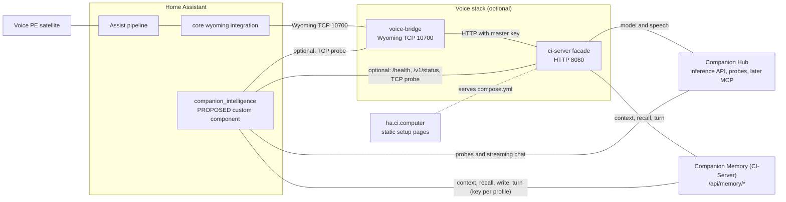

# Architecture

What this repository is made of, what runs where, and which names mean what. The
voice path described here runs today. The `companion_intelligence` custom component
is a proposal in [ADR-0001](decisions/0001-companion-intelligence-integration.md)
(status: proposed, waiting for the owner) and is not built yet. The full design is
the [rework plan](plans/2026-09-29-ha-integration-rework.md).

Separately, the working tree holds edits to the voice bridge that change some of its
behaviour. They are not part of the proposal, not approved and not published, and
the published images do not contain them. See
[the section below](#voice-bridge-changes-waiting-in-the-working-tree).

## Glossary: three names that stay apart

| Written as | Means |
|---|---|
| `ci-server/` (a directory, lowercase, with a slash) | The voice facade in this repository: Node 20, TypeScript, Express, an OpenAI-compatible API on HTTP 8080. The Docker context of the image `ci-ha-voice-server`. **Not** CI-Server. |
| CI-Server (capitalized, no slash) | Companion Memory, the memory brain of the platform, in the repository `companionintelligence/CI-Server`. The memory API is under `<origin>/api`. |
| CI-Hub | Companion Hub, the app runtime and inference pool, in the repository `companionintelligence/CI-Hub`. It hosts the store listing `ci-ha-voice`. Not the Portal (`hub.ci.computer` is the Portal). |

Other names:

- `voice-bridge/` is the Wyoming TCP server, the Docker context of `ci-ha-voice-bridge`.
- **Companion Voice** is the feature name of the voice path: the bridge, the facade
  and the setup site at https://ha.ci.computer.
- **Companion Intelligence** and `companion_intelligence` are the proposed display
  name and domain of the integration. Proposed only.
- **Wyoming** is the protocol Home Assistant uses to reach speech and conversation
  services over TCP. Home Assistant's core `wyoming` integration talks to the bridge.

## Diagram

The dotted line only means the site serves the `compose.yml` that pulls the two
images, it is not a runtime call. The node in the Home Assistant box named
`companion_intelligence` is proposed and does not exist yet. The voice stack box
shows the published images. The unpublished bridge edits are described below.

In the compose stack the facade calls the `ollama` service, and the optional
`speaches` service (profile `local-audio`) when local speech is wanted. Under
Companion Hub the two voice containers run together as the store app `ci-ha-voice`,
and the Hub injects their model and memory settings. The proposed integration never
uses that brokered key.

## What runs where

| Piece | Runs where | Talks to | State |
|---|---|---|---|
| Voice PE satellite | The Home Assistant Voice Preview Edition device | Home Assistant, through the Assist pipeline | Runs today |
| Home Assistant: Assist pipeline and the core `wyoming` integration | The person's own Home Assistant, any install type | `voice-bridge` on Wyoming TCP 10700 | Runs today |
| `voice-bridge/` (image `ci-ha-voice-bridge`) | Compose service `voice-bridge`, or the Hub store app `ci-ha-voice`. The published image advertises the programs `companion-stt`, `companion-tts` and `companion-conversation`, and so does the tree by default. | The facade over HTTP, with the master key | Runs today. Unpublished edits are waiting, see below |
| `ci-server/` facade (image `ci-ha-voice-server`) | Compose service `ci-server` on HTTP 8080, or the Hub store app `ci-ha-voice` | A model (Ollama, or the Hub inference pool), speech engines, and CI-Server through `/memory/context`, `/memory/recall` and `/memory/turn` | Runs today |
| Model and speech engines | `ollama` (and optionally `speaches`) in the compose stack, or the Hub inference pool | Called by the facade | Runs today, not part of this repository |
| Companion Hub (CI-Hub) | The person's Hub | Hosts the store listing and the inference API | Runs today, not part of this repository |
| Companion Memory (CI-Server) | Its own deployment, or the Companion Memory app on a Hub | Answers the facade's memory calls | Runs today, not part of this repository |
| Setup site https://ha.ci.computer (`web/`) | Cloudflare Worker `ci-ha-voice-setup`, static files. It also serves the real `compose.yml` people download. | None at runtime | Runs today |
| `custom_components/companion_intelligence/` | Inside the Home Assistant configuration directory | Hub (probes, streaming chat), Memory (context, recall, write, turn, one key per profile) and, optionally, the facade and the bridge | Proposed, not built |

## The voice path today

A spoken question goes from the Voice PE to Home Assistant's Assist pipeline, then
over Wyoming on TCP 10700 to `voice-bridge`, then over HTTP on 8080 to the facade,
which asks a local model (Ollama, or the Hub inference pool) and grounds the answer
in Companion Memory when `CI_MEMORY_URL` and `CI_MEMORY_API_KEY` are both set. The
answer returns the same way.

This path needs no custom component and works with the proposed integration absent.
The integration proposal changes none of it: same programs, same images, same
environment variable names, same Hub listing, same `compose.yml`, same Memory label
`ha-voice-pe`. The frozen list is in ADR-0001, decision 5.

If you already run voice, the integration asks nothing of you. The bridge edits
below are a separate matter, and until an image or a rebuilt checkout carries them,
nothing about your voice setup changes.

## Voice bridge changes waiting in the working tree

Not part of the integration proposal, not approved by the owner and not published.
The full list, the reasons and the owner question are in
[ADR-0001](decisions/0001-companion-intelligence-integration.md), section "Voice
bridge changes waiting in the working tree". At default settings they change:

- An `error` event now ends the connection. In the Home Assistant releases checked
  from 2025.11 to 2026.7, the speech clients ignore an error event and wait for a
  transcript or audio with no timeout, so today a failed request can leave the
  pipeline waiting.
- A failed conversation request is spoken by cause: the key was rejected, the
  facade is busy, it took too long, it sent back something unusable, or it could not
  be reached (the sentence spoken today for every failure).
- Transcripts and replies stay out of the log. The log shows only their lengths.
- An event the bridge cannot parse gets an `invalid-event` error and a close,
  instead of a silent drop.
- A conversation turn is remembered only after its answer has been sent.

Off by default: `HIDE_UNCONFIGURED_SPEECH` leaves `companion-stt` or `companion-tts`
out of the bridge's answer when the facade reports no speech provider. With it on
and no speech configured, the Wyoming entry is titled `companion-conversation` and
has no speech-to-text or text-to-speech entity.

| Optional variable | Default | Effect |
|---|---|---|
| `LOG_TRANSCRIPTS` | off | Log what people say and what they hear back. Troubleshooting only. |
| `HIDE_UNCONFIGURED_SPEECH` | off | Leave out speech services the facade reports as `none`. |
| `DEBUG` | off | Debug logging. Only 1, true, yes and on count, so `0` and `false` stay quiet. |

None of them is in `.env.example` or in either compose file, and both compose files
give the bridge an explicit list of variables, so a value in `.env` never reaches the
container. Set one through a compose override file. Merging alone publishes no image:
a stack built from a checkout gets the edits at its next rebuild, a stack from
https://ha.ci.computer/compose.yml gets them only after someone publishes and pulls
`:latest`, and a Hub install keeps its `sha-d5a7c86` pins until the listing changes.

## Where to read more

- [ADR-0001](decisions/0001-companion-intelligence-integration.md): the proposed
  decisions, the freeze list and what may leave the private repository.
- [Rework plan](plans/2026-09-29-ha-integration-rework.md): phases, credentials,
  security and testing.
- [Launch plan](plans/2026-09-28-ha-voice-launch.md): the voice launch checklist.
- [README](../README.md): setup for the voice path.
