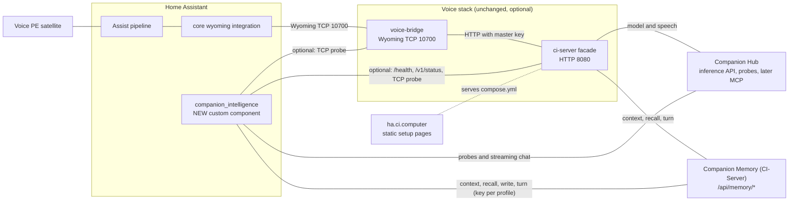

# Companion Intelligence for Home Assistant: integration rework

Date: 2026-09-29. Owner: Liam.
Status: draft for review, nothing here is approved yet. Progress is tracked in the pull request.

How to read this. **Verified** means read in source at the cited path, or run in the planning environment. **Inferred** follows from verified facts. **Unverified** was never observed. No live Hub or CI-Server was reachable while planning, so for them "verified" means source-verified only. Evidence notes are dated 2026-09-29: Python 3.14.7, Home Assistant 2025.10.4, 2026.2.3, 2026.3.4, 2026.5.4, 2026.7.4, 2026.8.3 and 2026.9.4 packages unpacked or installed in scratch environments, CI-Hub and CI-Server source read from git and from GitHub tags. Three names stay apart everywhere: the directory `ci-server/` is the voice facade (Node, OpenAI-compatible), **CI-Server** is Companion Memory, **CI-Hub** is Companion Hub.

## Summary

- **What changes.** This repository becomes the Companion Intelligence integration for Home Assistant. A new custom component, `custom_components/companion_intelligence/`, connects one Home Assistant to a Companion Hub (health, model access), a Companion Memory (profile, recall, saved turns, one key per person) and, optionally, the existing voice stack. Voice becomes one capability among several. New beside it: a test rig (`ha-tests/`), a frozen-surface guard (`contracts/`), docs and a decision record.
- **What does not change.** Every published or referenced artifact: both GHCR images and their tags, the `ci-ha-voice` store listing, Wyoming TCP 10700 with `companion-stt`, `companion-tts` and `companion-conversation`, every env var name, ha.ci.computer and its `compose.yml`, the CI-Server grant for `ci-ha-voice`, the PolyForm Required Notice in `LICENSE.md`. No directory is moved, renamed or removed. The voice path still needs no custom component. People who run voice today keep working with no action (see "If you already run voice").
- **Why.** Core Home Assistant already reaches a Hub model pool (`ollama`, `litellm`). What it cannot do is ground answers in Companion Memory, offer Companion tools to any agent, or show Hub and Memory health with repairs. Additive work touches no published identifier, so voice cannot regress by accident, and it is the only shape one maintainer can test without a live Hub or CI-Server.
- **How it ships.** Eight small phases (P0 to P7). Each is its own PR, leaves `scripts/test-all.sh` green and leaves voice untouched. P0 and P1 protect voice and can land now. Nothing is announced or published until the Voice PE hardware test and launch post from the launch plan are done and you have decided visibility and licence. The one public path that could leak early, the `/integration/` page, is held out of the site deploy by a `.assetsignore` line until you decide (decision 31).
- **Biggest unknowns.** Every fake is derived from source, because no live Hub or CI-Server was available. Two owner decisions gate release: the name and domain (irreversible), and distribution and licence (the repo is private).

Basis: three candidate shapes (conservative, clean, native) were compared during planning. Native ranked first and this plan starts from it, with the grafts from the other two that the comparison listed. The comparison notes are not part of this repository.

## Decisions made

Each decision has a reason so you can overturn it. "Cost to overturn" is what changes if you do.

| # | Decision | Reason | Cost to overturn |
|---|---|---|---|
| 1 | Additive and native: new code beside the voice stack, nothing moved. | Every published surface stays byte compatible for free. Ranked first in the planning comparison. | Moves are mechanical later (26 lines in 6 machine-read files, measured in scratch copies: ci.yml, publish-images.yml, .gitignore, docker-compose.yml, e2e/test_stack.py, scripts/test-all.sh) once the frozen tests exist. |
| 2 | No directory is moved, renamed or removed, including `ci-server/`. | The only gain is clarity. Costs: conflicts with parallel agents, generated agent files that revert, and a measured silent failure (a stale path makes `e2e/test_stack.py` skip with exit 0, line 125). A glossary fixes the confusion in words. | Reopen if `ci-server/` and CI-Server are mixed up twice by a contributor. |
| 3 | Display name Companion Intelligence, domain `companion_intelligence`. Voice stays a feature name (Companion Voice). Avoid `ci_server`, `ci_hub`, bare `companion` and Companion Voice as the umbrella. | The domain is absent from the roughly 1,510 core components in 2026.9.4. `ci_server` and `ci_hub` repeat the facade confusion, `companion` collides with the Home Assistant app, and CI-Voice is a private repo. | Free before P2. After entities exist it needs a migration. |
| 4 | The GitHub repository keeps its name. | The CI-Engineering generator aborts the whole org run on a renamed repo, and the GitHub description already presents the repo as a Home Assistant bridge to Memory and Hub. | Rename later with a generator change in the same window. |
| 5 | The integration talks straight to the Hub and Companion Memory. The facade and bridge stay optional companions it can observe. | The facade drops `tool_calls` in non-streaming chat, `/v1/responses` is text only, `response_format` is not forwarded. Direct calls avoid touching the published images. | Extending the facade later changes a Docker context and needs a deliberate publish. |
| 6 | One config entry per install with optional Hub and voice-stack connections (any one of Hub, a Memory profile or the voice stack is enough to start). Memory credentials live in `memory_profile` subentries from day one. A `conversation` subentry per agent, offered only when a Hub is connected (decision 27). | One key is one CI-Server user and Home Assistant gives an agent no speaker identity. Profiles as subentries let a household add people with no migration, and match device registry v3 (one device per entry and subentry). | Entry-level keys need a VERSION 2 migration later. |
| 7 | Hand-made, scoped keys only. No Hub connect principal, no new store id, no CI-Server change. | Connect keys exist only for Hub-installed containers. On CI-Server main an unlisted app id gets `memory`, `intents` and `mcp` at write (CI-Server main, `backend/apps/api/src/domains/auth/services/ConnectService.ts:36, 115`), wider than needed. | A future Hub-installed listing needs a `scopesForApp` and `capabilityForApp` case merged and deployed first. |
| 8 | `requirements` is an empty list. Home Assistant's shared aiohttp session, thin own clients. | No dependency in the shared interpreter, no `openai` or `mcp` package, NOTICE unaffected. | A library later needs a pinned requirement and hassfest review. |
| 9 | Floor Home Assistant 2025.10.0. Develop on 2026.9.x. Source valid on Python 3.13. Version branches only in `compat.py`. Default tests run 2026.9.4 and 2025.10.4. The matrix adds 2026.8.3 (first release with `llm.py` platforms and device registry v3) and 2026.2.3 (last Python 3.13 release), and must be green before P3, P4 and P6 merge and before any release zip is built. | Most interfaces the integration uses are stable across the range, but scanning the installed packages found differences that matter (table in Testing approach): the flow helper `ConfigFlow.async_update_and_abort` exists only from the 2025.11 series (absent on 2025.10.4), the `brand/` folder is served only from the 2026.3 series, and the `llm` platform and registry v3 arrive in the 2026.8 series. No install-base data was reachable. | Raising the floor to 2026.9.0 deletes the shims and the floor venv and excludes users not on the newest month. |
| 10 | Entry unique id is a random UUID minted at first setup and never changed. Duplicates are found by scanning stored origins (Hub origin across entries, Memory origin across `memory_profile` subentries). No Hub device id is read or stored. | An id derived from an address needs a migration when a Memory-only entry gains a Hub or a Hub moves, and a key hash changes on rotation. The only keyless source of a Hub device id is a Portal registration route whose body carries a live one-time registration nonce (`registration.controller.ts:136-174`), which this integration must not touch. | Changing the id later needs a migration. |
| 11 | The first agent has no Assist control. Control arrives in P6, default off, after live tool evidence, with an acknowledgement when memory is also on. | Memory can hold ingested third-party text (confused deputy). The Hub reports no per-model tool support. Big exposed-entity lists cost prefill time. | Adding control to P4 grows the riskiest phase. |
| 12 | Companion tools are exposed only through `llm.async_register_api`. No `llm.py` platform, plus a test that the Assist tool list is unchanged. | On 2026.8 and later, platform tools may join Assist for every agent, cloud agents included (inferred). | An `llm.py` platform needs a leak review first. |
| 13 | Saved turns are off by default. Platform label `home-assistant`; voice keeps `ha-voice-pe`. | Minimal write authority, and the two histories stay separable. | Changing a label splits stored history. |
| 14 | Memory grounding is deny by default and applies to a request only when its satellite is in the agent's `memory_satellites` list or its Home Assistant user is in the agent's `memory_users` list. A request with a device id that is in neither list, or with neither a satellite nor a user, is not grounded. The user list is prefilled with the owner. | `ConversationInput` carries `context` (a `Context` with `user_id`, verified at conversation/models.py:31 on 2025.10.4 and 2026.2.3, present on 2026.9.4) but no speaker identity (that `user_id` is None for Voice PE is unverified). Without a list, anyone in earshot or with a dashboard login gets the owner's profile. Only as trustworthy as the network path to Home Assistant. | A default of "all" is one config value away, and weaker. |
| 15 | Capability probe: `POST /memory/turn` with one system-role message. 201 with `created 0, skipped 1` means write. 403 means read only. Anything else means unknown: saving stays off and setup continues. The probe runs only inside flow steps, never on a timer. The `/agent/intents` over-privilege probe is dropped. | System-role messages are skipped and never stored (CI-Server main, `backend/apps/api/src/domains/agent/controllers/MemoryController.ts:175-184, 233`, verified). The intents route was never confirmed and a 404 would read as "not broad". Unknown never grants. | The empty-body probe is an alternative, but rests on guard order that was only inferred. |
| 16 | Release safety: keep the `v*` image trigger. Add a hyphen guard for `latest` and a `dry_run` dispatch input whose default is `false`, so the documented command `gh workflow run publish-images.yml --ref main` (publish-images.yml:6-7) still pushes. Integration tags are bare `X.Y.Z`. If HACS refuses bare tags, split to `voice-v*` for images. Comment-only facade fixes ride the next functional change and are not published on their own. | Any `v*` tag and any dispatch on main moves `latest` (publish-images.yml:13, 46), which public `compose.yml` pulls. A default of `true` would silently turn the documented release command into a no-op. No `v*` tag exists yet, so the fallback is cheap. | The split touches README line 201, both workflow headers and the frozen test. |
| 17 | No public artifact until you decide visibility and licence: no zip on ha.ci.computer, no HACS listing, no mirror, no `/integration/` page. A private release zip is built and attached privately. The page may merge before then, but `web/public/.assetsignore` keeps it out of the deploy (decision 31). | The repo is private and PolyForm Noncommercial, CLAUDE.md says Private and Confidential, and HACS cannot use private repos at all. | Publishing is one deploy away once decided. |
| 18 | Voice launch first. P0 and P1 land now. Integration code proceeds in parallel, but nothing is announced or released until the Voice PE hardware test and launch post are done. The README rewrite waits for P5. | The launch checklist still has those lines open. Proving voice first keeps the pitch honest. | Announcing earlier risks a pitch the voice path has not yet earned. |
| 19 | Discovery is manual: an address field, prefilled from `HUB_INFERENCE_URL` when present. No mDNS in the manifest, no port scanning. | The Hub desktop app browses `_ci-hub._tcp.local.` (discovery.rs:5, `docs/ARCHITECTURE.md:468`), but no advertiser exists in the Hub repository (grep for mdns, avahi and ServiceInfo found only that browser). One may exist outside the repo (CI-OS, unchecked). | Discovery needs a confirmed advertiser first. |
| 20 | Do not build on the Hub session REST API, SSE, `/api/apps/guest` or the credentials endpoint. Status uses MCP polling with a dedicated read key, later (P7, experimental). | Those routes are session or container bound (verified). SSE cannot use a key. | A scoped read-only status key from the Hub would replace MCP. |
| 21 | No unified VERSION file. Images keep 1.1.0 (facade) and 2.0.0 (Wyoming Info). The integration starts at 0.1.0. | A unified version couples release trains and edits Docker contexts. | Doable later with `scripts/version.py`. |
| 22 | Skip core readiness (`quality_scale.yaml`, strict mypy). Keep `client/` free of `homeassistant` imports. | PolyForm Noncommercial and a private repo block core. Hassfest handling of `quality_scale.yaml` for custom integrations is unverified. The import rule is a cheap seam. | Add later if the licence changes. |
| 23 | Guards fail instead of skip under CI: e2e (`REQUIRE_E2E`) and the Home Assistant step (`REQUIRE_HA`, or `CI=true`). Coverage is reported with an 85 percent gate. | A silent skip is a silent green. A 95 or 100 percent gate is heavy for one maintainer. | Tighten once the suite exists. |
| 24 | The v0.1 stop line: status entities, one Memory-grounded agent, `remember` and `recall`. Everything else is opportunistic and never blocks a release. | Effort in proportion to value for one person. | None. |
| 25 | Uninstall is clean: `async_remove_entry` deletes repair issues and cached blocks, and the docs tell people to revoke their keys. Saved turns stay in Memory under `home-assistant`. `docs/integration/removal.md` gives the order: delete the entry first, then the folder. | Neither console expires keys or offers introspection. | None. |
| 26 | Tooling: `uv` is allowed only inside `scripts/test-ha.sh`, to fetch Python 3.14 and create the Home Assistant test venvs (`uv venv --seed`). Every requirements file is installed with `python -m pip install -r` inside those venvs. pip stays the manager for `voice-bridge/` and the test venvs, npm for `ci-server/` and `web/`. No yarn, pnpm or bun, no `pyproject.toml`, no uv lockfile. | CLAUDE.md fixes pip for `voice-bridge/`, npm for `ci-server/` and `web/`, and forbids yarn, pnpm and bun. The stock uv 0.8.17 only installs Python 3.14.0rc2 and Home Assistant needs 3.14.2, so uv 0.12 from PyPI bootstraps the interpreter. Checked 2026-09-29: a `uv venv --seed` environment installed a pin from a requirements file with pip 26.2.1. The ADR and the generator entry drafted for `setup-agentic-configs.sh:1087` name uv as an allowed bootstrap tool, so an agent neither treats it as forbidden nor spreads it. | Use only the system Python 3.13 and drop the latest venv, which loses coverage of 2026.3 and newer. |
| 27 | What each setup gets (matrix in "What the integration offers"). Hub only: Hub entities and an agent without memory. Memory only: Memory entities and `remember` and `recall`, no agent. Both: everything. Voice stack only: gateway and bridge entities and repairs. Reconfigure can add a Hub, a Memory profile or the voice stack later and remove the voice stack. The `conversation` subentry type is offered only when the entry has a Hub. Deleting the last Memory profile of a Memory-only entry raises a repair and never deletes the entry. | An agent needs a model source, and only a Hub is one in v0.1. Voice users want status entities without a Hub. `async_get_supported_subentry_types(cls, config_entry)` receives the entry (config_entries.py:2856 on 2025.10.4), so the offer can depend on it. Origin scanning (decision 10) lets a Hub be added to a Memory-only entry without an id change. | An agent with no Hub needs the facade route (Later tier). |
| 28 | Cloud fallback and grounding: while the Hub reports `cloudFallback` true, or has not answered its health call with an explicit false, an agent adds no Memory blocks to the prompt unless its `allow_memory_with_cloud_fallback` option is ticked. | With fallback on, a chat request can leave the home and the profile and recall blocks would go with it. The integration cannot see per-request routing. Failing closed on unknown matches the rule that unknown never grants. | An agent loses grounding whenever the Hub health call fails, which is when chat fails anyway. A Hub that omits the field (not checked) needs the box ticked. |
| 29 | Licence handling: no code is copied from Home Assistant core (structure follows the documented subentry, streaming and manifest patterns). If a core file is ever adapted, the same PR adds an Apache-2.0 line to `NOTICE.md`. `LICENSE.md` line 3 (Required Notice) is frozen by a test. The line 1 banner and `docs/License-FAQ.md` change only with wording you approve (draft in P5). The ADR states that Lifescope as licensor is not bound by PolyForm, but a third party that sells an appliance shipping the integration is (License FAQ: selling appliances that ship the code is not permitted). | PolyForm requires copies to carry the Required Notice (LICENSE.md:3), and the release zip ships `LICENSE.md`. Core is Apache-2.0, so adapted code needs attribution. Whether the Hub may seed the integration into a Hub-run Home Assistant stays deferred. | Wording only. |
| 30 | Release bookkeeping: `docs/releasing.md` carries the table of minimum Hub, CI-Server and facade releases (see "Minimum releases"). `CHANGELOG.md` at the repository root is the release notes source. A release PR bumps `manifest.json` `version`, the changelog and that table together (`hacs.json` has no version key). `release-integration.yml` refuses a tag that differs from the manifest. | The integration probes Hub routes that shipped in different releases (identify by v0.2.70, key access in v0.2.73, build in v0.2.74). Without a written floor, a user on an old Hub sees a broken sensor. | None. |
| 31 | Site deploy gating: `web/public/.assetsignore` lists `integration/` until G3. The frozen web test asserts the line exists while `contracts/frozen-surfaces.json` says `distribution_decided: false` and that it is gone when the flag is `true`. The PR that flips the flag removes the line and repoints the manifest `documentation` URL. Every PR that touches `web/**` says so in its description, because that merge runs the production deploy. | `deploy-web.yml` runs on every push to main that touches `web/**` and runs `npx wrangler deploy` whenever both Cloudflare secrets exist (deploy-web.yml:16-22, 60-65). The launch plan's first checklist line adds those secrets, `web/README.md:60-71` documents a dashboard route that also deploys from main, and wrangler publishes all of `./public` (wrangler.toml:9). Checked 2026-09-29 with wrangler 4.142.0 and a local `wrangler dev` (workerd): `/integration/` answered 200 without the ignore file and 404 with a line `integration/` in `web/public/.assetsignore`, and `/` answered 200 in both. Production behaviour of the same asset manifest is inferred, and the first real deploy after G3 checks it. | Keeping the draft outside `web/public` also works but needs a move at G3. |
| 32 | Manifest links: `documentation` is `https://github.com/companionintelligence/CI-Home-Assistant-Voice-PE/blob/main/docs/integration/install.md` and `issue_tracker` is `https://github.com/companionintelligence/CI-Home-Assistant-Voice-PE/issues`. Both switch to public URLs in the G3 PR. | HACS requires `issue_tracker` (its manifest schema marks `codeowners`, `documentation`, `domain`, `issue_tracker`, `name` and `version` as required) while hassfest treats it as optional, so hassfest alone can pass a manifest that HACS rejects. Anyone who can install the private zip has repo access, so these links work for exactly that audience. Pointing `documentation` at https://ha.ci.computer would land on the voice-only setup page. | Both URLs 404 for outsiders once the zip circulates beyond repo access, which question 2 covers. |

## Target architecture

### Diagram



Under Companion Hub the two voice containers run as the `ci-ha-voice` store app and the Hub injects their model and memory settings. The integration never uses that brokered key.

### Repository layout

Every directory is marked. There are no moves and no removals in this design (decisions 1 and 2).

```
.                                   [keep]  repo root
  hacs.json                         [add]   HACS metadata (file, root)
  SECURITY.md                       [add]   private reporting route (P5)
  CHANGELOG.md                      [add]   release notes source (P5)
  .claude/                          [keep]  generated settings
  .github/                          [keep]
    workflows/                      [keep]  ci.yml, publish-images.yml edited additively;
                                            adds ha-validate.yml, release-integration.yml
  ci-server/                        [keep]  voice facade, Docker context of ci-ha-voice-server;
                                            comment fixes and the package.json description only
    src/                            [keep]
      memory/                       [keep]
      middleware/                   [keep]
      normalizers/                  [keep]
      providers/                    [keep]
      routes/                       [keep]  status.ts comment fix only
      store/                        [keep]  dead code, left alone
    tests/                          [keep]  status.test.ts comment fix only
  contracts/                        [add]   frozen-surfaces.json (also holds distribution_decided
                                            and the sha256 of the committed brand icons)
    upstream/                       [add]   ci-hub.json, companion-memory.json (routes and source commits)
  custom_components/                [add]
    companion_intelligence/         [add]   the integration; ships to users; no tests inside
      client/                       [add]   HA-free HTTP clients
      translations/                 [add]   en.json, fully expanded
      brand/                        [add]   icon.png, icon@2x.png, logo and dark variants
  db/                               [keep]
    migrations/                     [keep]  dead schema; POSTGRES_PASSWORD still required
  docs/                             [keep]  gains architecture.md, releasing.md
    decisions/                      [add]   0001 decision record
    integration/                    [add]   install (with the capability matrix and per-install-type steps),
                                            existing-voice-users, removal, keys, privacy, development,
                                            voice, model-access
    plans/                          [keep]  gains this plan and cross-repo-asks.md
  e2e/                              [keep]  gains status pin and fail-not-skip
  ha-tests/                         [add]   own rootdir, pytest.ini, conftest, requirements per HA version
    fakes/                          [add]   strict FakeHub, FakeMemory, FakeGateway
    fixtures/                       [add]   sanitized live responses, entry_v1.json
    tests/                          [add]
  scripts/                          [keep]  gains test-ha.sh, hassfest.sh, live-check.py,
                                            check-upstream-contracts.sh, two container smokes,
                                            vendor-brand.sh, build-integration-zip.sh
  vendor/                           [add]   gitignored; brand bundle pulled by vendor-brand.sh;
                                            only the derived brand icons inside the integration are committed
  voice-bridge/                     [keep]  Wyoming server, Docker context of ci-ha-voice-bridge
    src/                            [keep]
      audio/                        [keep]
      client/                       [keep]
      wyoming/                      [keep]
    tests/                          [keep]
  web/                              [keep]  ha.ci.computer Worker
    public/                         [keep]  compose.yml byte identical
      .assetsignore                 [add]   P1: lists integration/ until G3 (decision 31)
      fonts/                        [keep]
      integration/                  [add]   P5, merged but not deployed until G3
    test/                           [keep]  gains frozen-surfaces.test.mjs
```

Root files: `README.md` [keep, rewritten in P5, line 23 scoped in P0], `.gitignore` [keep, adds `/.ha-venv/`, `/*.whl` and `/vendor/`], `docker-compose.yml` and `.env.example` [keep, byte identical], `LICENSE.md` [keep, line 3 frozen, line 1 banner only with your wording], `NOTICE.md`, `THIRD_PARTY.md`, `CREDITS.md` [keep, generated by `scripts/generate-attribution.mjs` in CI-Engineering, never hand edited beyond the P0 reconciliation], `CLAUDE.md`, `AGENTS.md`, `ANTIGRAVITY.md`, `opencode.json` [keep, generated]. The stray untracked `wyoming-1.10.2-py3-none-any.whl` is ignored, not deleted (another agent's file).

The existing `.gitignore` has unanchored `dist/` (line 12), `venv/` (14) and `env/` (15). `git check-ignore -v` shows they silently ignore `custom_components/companion_intelligence/www/dist/card.js`, `.../env/x.json` and `.../venv/x.py`, and do not ignore `.../brand/icon.png` (checked 2026-09-29). P2 therefore adds a test that `git ls-files custom_components` equals the files on disk. If a bundled frontend is ever added, a nested `custom_components/.gitignore` with `!dist/` is the fix.

### Modules inside the integration

| Module | Job |
|---|---|
| `__init__.py` | Version guard, admin services in `async_setup`, `runtime_data` (clients, coordinators, caches), one update listener that reloads (registered first in `async_setup_entry`, and removed by Home Assistant when setup fails), `async_remove_entry` cleanup. |
| `compat.py` | The only place with Home Assistant version or library branches, and the only place that finishes a flow on an existing entry. It holds the floor guard (awesomeversion), the JSON schema converter (`probatio.to_openapi` when `vol.Schema` comes from probatio, else `voluptuous_openapi.convert`, sentinel from the same library) and `update_and_abort(flow, entry, data_updates, reason)`: `async_update_entry`, then `async_schedule_reload` when the entry is not loaded, then `async_abort`. It uses no version branch, because `ConfigFlow.async_update_and_abort` exists only from the 2025.11 series. |
| `client/` | Pure aiohttp clients: `urls`, `errors`, `hub`, `memory`, `gateway`, later `sse` and `mcp`. Redirects off, per-call timeouts, size caps. An AST test forbids `homeassistant` imports. |
| `coordinator.py` | Hub (60 s, models every 10 min, build once), one per Memory profile (health 5 min, key check hourly), voice stack (60 s). Holds the capability record (which optional routes answered). |
| `config_flow.py` | Menu flow, `memory_profile` and `conversation` subentry flows, reauth, reconfigure. Existing entries are only ever changed through `compat.update_and_abort`. |
| `entity.py`, `sensor.py`, `binary_sensor.py` | Flat devices, `has_entity_name`, no `via_device`. |
| `grounding.py`, `messages.py`, `conversation.py` | P4: Memory grounding, message mapping, streaming agent. |
| `repairs.py`, `diagnostics.py` | Repairs with plain wording, redacted diagnostics. |
| `llm_api.py`, `ai_task.py` | P6. |

## Compatibility promises

| Artifact | Fate | How compatibility is kept |
|---|---|---|
| GHCR `ghcr.io/companionintelligence/ci-ha-voice-server` and `ci-ha-voice-bridge`, tags `latest` and `sha-d5a7c86`, digests pinned by the Hub listing | Unchanged | The Docker contexts `ci-server/` and `voice-bridge/` get no functional edit. Nothing is deleted or retagged. The frozen test pins package names, matrix contexts (publish-images.yml:27, 29) and the OCI labels title, vendor and url (publish-images.yml:49-51). |
| Behaviour behind `latest` (public `compose.yml` pulls it) | Guarded | Hyphen guard and `dry_run` (default `false`, so the documented dispatch command still pushes, with a frozen assertion that a dispatch with no inputs sets push true). Documented rollback by pinning `sha-d5a7c86` in `docs/releasing.md`. Integration tags never match `v*`. |
| Hub store listing `ci-ha-voice` in CI-Marketplace: id, pins, `CI_LLM_BASE_URL`, `CI_LLM_API_KEY`, `CI_CHAT_MODEL`, `CI_MEMORY_URL`, `CI_MEMORY_API_KEY`, form fields, service names `ci-ha-voice-server` and `ci-ha-voice-bridge`, `CI_SERVER_URL=http://ci-ha-voice-server:8080`, bridge host port 10700, listing port 10780, version 1.1.0, `min_hub_version` v0.2.41, CORS origin | Unchanged | No new listing or store id. Env and service names are in the frozen JSON. The listing is on CI-Marketplace `main` and `dev` (checked through GitHub on 2026-09-29; the local clone is stale and shows only `dev`), and whether the deployed store has picked it up is unverified. Its `source`, `website` and `documentation` fields (config.json:17-19) point at this private repo and at the voice-only setup page, so outsiders get a 404 and Hub users of the integration get the wrong page (question 2). Ask the Hub owners whether `min_hub_version` should rise to the release with multipart audio (Hub commit e45fb14, in no tagged release yet, latest is v0.2.76). |
| Store deep link `https://hub.ci.computer/install#ci-ha-voice` (web/public/config.js:29, index.html:300) | Unchanged | It joins on the store id. Pinned in the frozen test. |
| Store listing text (`metadata/description.md`, config.json description) | Optional edit after G3 | Today it says "Zero-config on the Hub" and describes Wyoming only, so nothing tells a Hub user the integration exists. The draft adds one sentence that points at the integration docs. CI-Marketplace tests constrain any edit: `id` equals the directory, the port is unique and grantable, internal apps carry the `companion-intelligence` category (apps.test.ts:238-296, 1272-1328; internal-apps.test.ts:42). |
| CI-Server grant for `ci-ha-voice` (scope `memory`, capability `write`, label Home Assistant Voice) | Unchanged | The integration uses hand-made keys, so it needs no CI-Server change. Rule: no new Hub app id before its `scopesForApp` and `capabilityForApp` case ships. |
| Memory platform label `ha-voice-pe` | Frozen for voice | The native agent writes `home-assistant`. |
| Wyoming TCP 10700, programs `companion-stt`, `companion-tts`, `companion-conversation`, zeroconf name `companion-voice` (voice-bridge/src/config.py:34, 36; wyoming/info.py:21-23) | Unchanged | Bridge untouched. The manifest declares no zeroconf and never `_wyoming._tcp.local.`. The integration never imports `wyoming`. Pinned by the e2e Describe assertions, the frozen test and the P1 container check. |
| Existing Wyoming entries in Home Assistant (keyed by host and port, unique ids `entry_id-stt`, `-tts`, `-conversation`) and their pipelines | Unaffected | Different domain, separate entities. The coexistence test in P3 loads both together. |
| Facade HTTP contract on 8080 and `/v1/status` field names | Unchanged, additive only | Frozen test plus a behavioural pin in the e2e fixture. The ha.ci.computer checker reads the same fields. |
| Env var names (`.env.example`, both compose files, site generator, Hub form fields) | Unchanged | The integration adds none (it only reads `HUB_INFERENCE_URL` to prefill a field). The compose drift test stays. |
| `docker-compose.yml`, service keys `ci-server` and `voice-bridge`, `http://ci-server:8080` | Unchanged | A renamed service key would leave orphan containers holding ports 8080 and 10700 (inferred, standard compose behaviour). |
| https://ha.ci.computer/compose.yml (real file, `text/yaml`, inline, `web/public/_headers`) | Byte identical | `git diff --exit-code web/public/compose.yml` in every phase. Headers pinned. Never a redirect. |
| https://ha.ci.computer/, title "Companion Voice for Home Assistant", Worker `ci-ha-voice-setup`, custom domain (web/wrangler.toml:4, 16) | Unchanged, one path added in P5 | deploy-web.yml greps (lines 70-71) stay true. `/integration/` is merged in P5 but held out of the deploy by `web/public/.assetsignore` until G3 (decision 31). |
| localStorage key `ci-ha-voice-setup-v1` (web/public/app.js:19) | Unchanged | `/integration/` shares the origin. It never reads or writes that key, uses no `localStorage` at all in v0.1, and the web test asserts the page has no inline script. |
| Directory names `ci-server/`, `voice-bridge/`, `web/`, `e2e/`, `db/`, `scripts/`, `docs/` | Unchanged | No moves. |
| Test suites and entry points (Jest 44, pytest 22, e2e 1, web 25, `scripts/test-all.sh`, ci.yml jobs, artifact `ci-server-dist`) | Unchanged, additive | New steps are appended and new jobs added. Hosted CI stays dispatch only. |
| Package managers named in CLAUDE.md: pip for `voice-bridge/`, npm for `ci-server/` and `web/`, no yarn, pnpm or bun | Unchanged | `uv` is a bootstrap tool inside `scripts/test-ha.sh` only, and requirements are installed with pip (decision 26). |
| CI-Common `CONSUMING.md:154-157`: "CI-OMI, CI-MaixCAM, CI-Pebble, CI-Home-Assistant-Voice-PE carry no brand colour, logo or copy today and are exempt until they do" | Lapses in P5 | The integration vendors brand files and adds a page, and `web/public/styles.css` already hard-codes brand hexes, so the exemption stops holding. P5 pulls the pinned bundle (Route B, `CONSUMING.md:94-135`) into the gitignored `vendor/brand/`, runs the gate (`CONSUMING.md:137`) on the new files only, and `cross-repo-asks.md` asks CI-Common to update the sentence. |
| `publish-images.yml` trigger `v*` and the `type=semver` tags | Unchanged | Fallback if HACS refuses bare tags: `voice-v*` with `type=match`, no `v*` tag exists yet. |
| CI-Docs page `home-assistant-voice-pe` (four inbound links in CI-Docs: home.tsx:199, omi.mdx:53, _meta.ts:22, index.mdx:115; two more in this repo: README.md:10 and web/public/index.html:422; no `_redirects` rule today) | Slug kept, wording scoped | Draft PR. If a slug ever changes, add a 301 in `public/_redirects`. |
| CI-Docs home for the general integration | New sibling page, drafted | `_meta.ts` already has a "Companion Integrations" group under App Catalog that holds this voice page, OpenClaw, Hermes and the device pages, so a `home-assistant` page joins that group and links to the voice page. The Hub docs need only a link. CI-Docs owners confirm the placement. |
| Claim "No custom components" (README.md:23, CI-Docs mdx:25) | Reworded | Scoped to the voice path: it needs no custom component, and an optional integration exists. |
| CI-Docs ROADMAP W3 (the facade owns the `/v1` contract) | Unchanged | The facade contract stays documented and frozen. |
| Repo name, description, private visibility | Unchanged | Generator drift guard. Visibility is your decision (question 2). |
| Generated agent files (`CLAUDE.md`, `AGENTS.md`, `ANTIGRAVITY.md`, `.github/copilot-instructions.md`, `opencode.json`, `.claude/settings.json`) | Edited only with the generator entry | `ci-engineering/scripts/setup-agentic-configs.sh:1087` change is drafted in `cross-repo-asks.md`. Hand edits revert on the next org run. |
| `NOTICE.md` versus `THIRD_PARTY.md` (zeroconf is LGPL-2.1-or-later; NOTICE.md:8-9 says no copyleft, THIRD_PARTY.md:68-70 lists it) | Reconciled in P0 | Docs only. `NOTICE.md`, `THIRD_PARTY.md` and `CREDITS.md` share the generated footer from `scripts/generate-attribution.mjs`, which is absent from the local CI-Engineering clone, so check the regenerated output once the integration exists. |
| `LICENSE.md`: line 1 banner names "Companion Home Assistant Voice PE", line 3 is the PolyForm Required Notice. The release zip ships this file. | Line 3 frozen, banner by your wording | PolyForm requires the Required Notice to travel with copies. A frozen test compares line 3 byte for byte. The P5 draft proposes a banner that names the repository and Companion Voice and needs your approval (question 2). |
| `docs/License-FAQ.md` (11 lines name the product and it describes the stack as `voice-bridge` plus a facade) | Unchanged until your wording | The P5 draft adds one paragraph covering the integration. The FAQ says selling appliances that ship the code is not permitted, and the ADR states how that reads for the Hub (decision 29). |
| `db/`, Postgres, Redis, `POSTGRES_PASSWORD` | Unchanged | Dead at runtime, but both compose files still require the variable. |
| The integration's own promises (new) | Frozen from 0.1.0 | Domain, entry keys, subentry types, `VERSION` and `MINOR_VERSION`, unique id rule, service names, LLM API tool names, label `home-assistant`. `ha-tests/fixtures/entry_v1.json` must keep loading. |

## What the integration offers

### Config flow and options (first release)

One entry, titled Companion Intelligence. Any one of a Hub, a Memory profile or the voice stack is enough to start, and the others can be added later (matrix below). Steps:

| Step | What it does |
|---|---|
| `user` | Menu: connect a Companion Hub, connect Companion Memory only, or connect the voice stack only. |
| `hub` | Address (host, host:port or URL; default port 5002). Strip path, query and fragment, reject credentials in the URL, allow only http and https. Plain http only for private targets (RFC1918, loopback, link-local, ULA, 100.64.0.0/10, `.local`, `.lan`, `.home.arpa`, `.internal`, single-label names). Advanced: verify certificate (default on). Prefill from `HUB_INFERENCE_URL` when set (path stripped). The source is verified: the Hub writes `http://<hub container name>:<API_PORT or 3000>/api/inference/v1` into the env file of every Hub-managed app (app.helpers.ts:1203-1205), so the value is a Docker-network hostname that reaches Home Assistant only if the app's compose forwards it. The store `home-assistant` app has no `hub_integration` (CI-Marketplace `apps/home-assistant/config.json`), so delivery is unverified and likely absent. The default port 5002 is the appliance compose value (docker-compose.prod.yml:113, 228; the code default is 3000, main.ts:115). Probes without a key, in order: `GET /api/inference/pool/identify` (must say `isCiHub`), `GET /api/health/live`, `GET /api/hub/build` (a 404 means a Hub older than v0.2.74 and is not an error), `GET /api/inference/health`, then `GET /api/inference/v1/models`. A 200 means the Hub admitted this address by origin. A 401 `missing_api_key` goes to `hub_key`. A 503 is retryable, never a bad key. |
| `hub_key` | Companion Hub key: 64 lowercase hex (trimmed, lowercased before use), checked with `GET /api/inference/v1/models` and a Bearer header. Optional when the Hub admitted the address, and then it cannot be checked (the Hub never reads it from a private origin). Help text: not needed on the home network, but makes the same setup work through a tunnel; Hub keys have no expiry, so make a new one and revoke the old one in Settings, Security. The key path exists only on Hub v0.2.73 or newer (see "Minimum releases"); older Hubs admit private addresses with no key and never read one. |
| `memory_profile` (subentry, add and reconfigure) | Name, Companion Memory address ending in `/api` (if `text/html` answers, retry once with `/api` appended and say so), key. Validation: `GET /health` must be JSON, then `GET /memory/context` (200 with a string `block`, 401 `invalid_auth`, 403 `missing_scope`, JSON 404 `wrong_path`), then the system-role capability probe. The plain-words checklist reuses the Memory dialog wording: tick only Memory, choose Read and write to let Home Assistant save conversations or Read only to only recall, never leave the areas empty because empty means full access. |
| `voice` (optional) | First asks how voice was installed, because the facade address differs. Docker compose: port 8080 (compose.yml publishes 8080). Companion Hub store app: port 10780 (listing `port`, CI-Marketplace `apps/ci-ha-voice/config.json:9`; the facade service has `internalPort` 8080 and no `addPorts`, and only the bridge gets host port 10700 in `docker-compose.json`; that 10780 reaches the facade is inferred from the Hub port rules, not observed). The master key is the Hub form field "Voice API key" (`MASTER_API_KEY`, generated by the Hub) or `MASTER_API_KEY` in the compose `.env`, and the step text says so. Wyoming port defaults to 10700. Host is prefilled when exactly one core `wyoming` entry has title `companion-stt` and port 10700 (core stores `host` and `port` in entry data, and the manual flow gives the entry the first program name as title, wyoming/config_flow.py:36-59 and data.py:56-87 on 2026.9.4). The integration reads that entry and never changes it. Checks `GET /health`, a TCP connect, and `GET /v1/status` when a key is given. Missing status fields read as unknown. Text: Assist voice keeps using the Wyoming integration and needs nothing here. |
| finish | `unique_id` is a random UUID (decision 10). Before creating, the flow scans every existing entry for the same Hub origin and every `memory_profile` subentry for the same Memory origin. A match aborts with `already_configured` and refreshes the stored address through `compat.update_and_abort`. Creates the entry with the first `memory_profile` subentry (when Memory was chosen), and in P4 a default `conversation` subentry when a Hub exists. |

Rules:

- Error keys are `cannot_connect`, `invalid_url`, `insecure_url`, `not_a_hub`, `ssl_error`, `invalid_key_format`, `invalid_auth`, `missing_scope`, `missing_api_suffix`, `wrong_path`, `not_json`, `unknown`.
- Reauth re-probes every stored credential and asks only for the ones that fail, so it also works when setup itself raised.
- Reconfigure changes the Hub address (with confirmation when the origin changes), adds a Hub to a Memory-only entry, and adds or removes the voice stack. There is no options flow.
- `VERSION` and `MINOR_VERSION` are set from day one.
- All HTTP uses `async_get_clientsession`, or `async_create_clientsession(verify_ssl=False)` only when the certificate box was cleared.
- The flow never calls a Hub session route, never asks for a Portal password and never requests capability `full`.

Reload rules, checked on the installed packages:

- One update listener reloads a loaded entry.
- Entry flows (reauth, reconfigure, the duplicate refresh) end through `compat.update_and_abort`. They never call `ConfigFlow.async_update_and_abort` (absent on 2025.10.4, present from 2025.11.3, config_entries.py:3288 on 2026.2.3).
- They never call `async_update_reload_and_abort` or `_abort_if_unique_id_configured(updates=...)`. From 2026.7.4 on, both log a usage report (breaking in 2026.12.0) when the entry has an update listener (config_entries.py:3139-3175 and 3547-3580 on 2026.9.4), and on every version they would reload a second time.
- When setup fails, Home Assistant removes the listener (`_async_process_on_unload` runs on ConfigEntryError, ConfigEntryAuthFailed and ConfigEntryNotReady, config_entries.py:778, 795, 838 on 2025.10.4), so a reauth that only updated the entry would never reload it. `compat.update_and_abort` therefore schedules the reload itself when the entry is not loaded (`async_schedule_reload` exists on 2025.10.4, 2026.2.3 and 2026.9.4, and cancels a pending retry).
- Subentry flows end with `async_create_entry` or `ConfigSubentryFlow.async_update_and_abort` (present on 2025.10.4, line 3448). Subentry changes notify the update listener (config_entries.py:2479-2520).

Conversation subentry (P4): name, model (picker from `/api/inference/v1/models` rows that are local and pulled, loaded or pinned, plus `auto` and free text, labelled "tool support unknown"), prompt, memory profile (or none), memory mode (off, profile, profile and recall), save turns (only when the profile can write, default off), recall results 1 to 20 (default 5), memory timeout 500 to 5000 ms (default 1500), memory satellites (multi-select of `assist_satellite` entities), memory users (multi-select of Home Assistant users from `hass.auth.async_get_users()`, system users left out, prefilled with the owner; `User.is_owner`, `is_active` and `system_generated` exist on 2025.10.4, auth/models.py:65-67), and `allow_memory_with_cloud_fallback` (default off, decision 28). Empty lists mean nobody gets memory. The subentry type is offered only when the entry has a Hub (decision 27). The step text says the Wyoming `companion-conversation` agent stays the default voice route and lists what this agent adds.

### What each setup gets

| Setup | Needs | Entities | Agent | Services |
|---|---|---|---|---|
| Hub only | Hub address (key only off the home network) | Hub sensors | `conversation` subentries with memory off | `remember` and `recall` answer with a translated "no Memory profile" error |
| Memory only | Memory address and key | Memory sensors per profile | none, there is no model source (the type is not offered) | `remember`, `recall` |
| Hub and Memory | both | all of the above | agents grounded by a chosen profile | `remember`, `recall` |
| Voice stack only | facade address (master key optional) | gateway and bridge sensors, facade repairs | none | none |

Any setup can gain the missing pieces later without a second entry: reconfigure adds the Hub or the voice stack, the Add button adds a Memory profile. Two different Hubs are two entries, and the same Hub twice is refused by the origin scan. Deleting the last Memory profile of a Memory-only entry raises the repair `nothing_connected` and keeps the entry. Deleting a profile that an agent uses turns that agent's memory off and raises `agent_profile_missing`.

### Getting the folder into Home Assistant

| Install type | Where the folder goes | Notes |
|---|---|---|
| Home Assistant OS or Supervised | `/config/custom_components/companion_intelligence/`, through the Samba, SSH or File editor apps, then restart | |
| Container | the host directory mounted at `/config` in the container, then restart the container | |
| Core | `custom_components/` next to `configuration.yaml`, then restart | |
| Home Assistant as a Companion Hub store app | the store app `home-assistant` mounts `${APP_DATA_DIR}/data/config` at `/config` (CI-Marketplace `apps/home-assistant`), so the folder goes under that path on the Hub host | that app has no `hub_integration`, so it receives no `CI_LLM_*` or Memory variables: type the Hub address in. The Hub does not seed the integration (deferred). |
| HACS | after G3 only, as a custom repository (option c) | never before, decision 17 |

Until G3 the only route is the private release zip, handed to people with repo access. Icons: Home Assistant serves `custom_components/<domain>/brand/` only from the 2026.3 series (`has_branding` is absent from 2025.10.4, 2026.1.3 and 2026.2.3 and present in 2026.3.4). On older versions the integration shows no icon and works otherwise. That is accepted, and `install.md` says so.

### First release (v0.1)

| Offer | Kind | Depends on | Exists today |
|---|---|---|---|
| Hub reachable | binary_sensor (connectivity), reads off when down | Hub `GET /api/health/live`, no key | yes (source) |
| Cloud fallback enabled | binary_sensor (problem) plus repair. While true or unknown it also switches agent grounding off (decision 28). | Hub `GET /api/inference/health`, field `cloudFallback` | yes (source, inference.controller.ts:267-277); which Hub release first reports it is unchecked, so a missing field reads as unknown |
| Inference status, hardware tier | sensors | Hub `GET /api/inference/health` | yes (source) |
| Hub version | sensor (diagnostic) | Hub `GET /api/hub/build` (`version`, or `gitShaShort` when null). Not `GET /api/version`, which is Ollama's. Field names verified in source (hub-build-info.ts:50-56), not observed live. | yes, first in Hub v0.2.74 (verified: the route file is absent at tag v0.2.73 and present at v0.2.74); on older Hubs the sensor reads unknown |
| Local models | sensor (count), feeds the model picker | Hub `GET /api/inference/v1/models`, key only off private networks | yes (source) |
| Memory connected | binary_sensor per profile | Memory `GET /api/health`, then `GET /memory/context` | yes (source) |
| Memory access | sensor per profile: `read_write`, `read_only`, `invalid`, `unknown` | context call plus the system-role probe | yes (source); probe never run live |
| Voice gateway reachable | binary_sensor | facade `GET /health` (this repo) | yes |
| Voice bridge reachable | binary_sensor | TCP connect to 10700 (this repo), no protocol traffic | yes |
| Companion agent | conversation entity per subentry, streaming, no control | Hub `POST /api/inference/v1/chat/completions` with `stream: true` and `X-Hub-Pool-Session`; Memory context, recall, turn, gated by the satellite and user lists (decision 14) | yes (source); tool_call framing through the pool unverified |
| `companion_intelligence.remember` and `.recall` | services, admin only; `recall` returns `block` and `resultCount` | Memory `POST /memory/write` (content 1 to 10000), `POST /memory/recall` (answers 201) | yes (source) |
| Repairs | cloud fallback, missing scope, read-only key while saving is requested, facade using OpenAI, Hub unreachable for 10 minutes, `nothing_connected`, `agent_profile_missing` | derived from the above | yes |
| Diagnostics | redacted config entry dump | none | yes |

### Next

| Offer | Kind | Depends on | Exists today |
|---|---|---|---|
| Companion tools for any agent (`companion_intelligence__recall`, `__remember`) | LLM API via `llm.async_register_api`, selectable per agent, `remember` off by default | Memory recall and write routes | yes (source) |
| Assist control in the agent | subentry option and capped tool loop | Hub chat forwards `tool_calls`; a model that supports tools | unverified (framing through the pool, model support) |
| Companion AI Task | `ai_task_data` subentry | Hub chat; structured output engine support unknown, so JSON is validated locally | yes (source), engine support unverified |
| Voice stack detail sensors (speech providers, memory ok) | sensors | facade `GET /v1/status` with the master key | yes (this repo) |
| Memory database and model health | sensors | Memory `GET /api/health/detailed` (main only, older releases 404) | yes on main (source), unverified on deployed releases |
| Backend running (per backend) | dynamic binary_sensors | Hub `/api/inference/health` `backends[]` | yes (source) |
| Hub load and app status | sensors, experimental option, off by default | Hub MCP `hub_system_load`, `hub_list_installed_apps`, `hub_get_operation_status`, read key | route yes (source), wire behaviour unverified |

### Later

Each item is its own PR and needs the named capability first.

| Offer | Depends on | Exists today |
|---|---|---|
| Hub app switches and restart buttons, per-app allowlist | Hub MCP `hub_start_app`, `hub_stop_app`, `hub_restart_app` at write, never full | yes (source), wire unverified |
| Hub speech-to-text and text-to-speech entities | Hub audio routes, offered only when `lemonade` runs (local) and `stt` and `tts` rows are pulled, else the Hub answers 502. A cloud provider is offered only with an explicit privacy acknowledgement. | yes (source), backend commonly absent on an Ollama-only Hub (inferred) |
| Tasks, calendar (read only), Daily Brief | CI-Server intents (`intents` scope, separate key) or Companion Planning; backend undecided | yes (source), backend choice open |
| Home events into Memory (opt-in allowlist) | CI-Server `POST /v1/events` with a capture-only key | yes (source), privacy design first |
| Agent through the voice facade for people with no Hub | facade streaming chat (tool_calls survive only when streaming); grounding switched off to avoid double injection | yes (this repo) |
| Per-user profile choice (each Home Assistant user gets their own Memory profile) | profiles already exist; needs a user-to-profile setting. The v0.1 user allow list only decides who is grounded, not which profile answers. | yes |
| Hub update sensor | Hub MCP `hub_check_for_updates` | yes (source) |
| Discovery of a Hub | a confirmed advertiser of `_ci-hub._tcp.local.` (the desktop app browses it, discovery.rs:5; no advertiser in the Hub repo, one may exist outside it) | no |
| `forget` | forget by query with confirmation and an approval flow (the intent needs `full`, UUIDs and owner approval) | no |
| Push (Daily Brief, Hub events) | outbound webhook or key-authenticated event stream (none today: SSE needs a session) | no |
| Scoped read-only Hub status key | Hub change | no |
| Image generation | a Hub image route | no |

### Tier 0: docs only, no code

Say plainly that core already does model access. Core `ollama` at `http://<hub>:5002/api/inference/pool` (not the API root: the root answers only `GET /api/tags` and `/api/version`, so setup validates and then chat returns 404). Core `litellm` at `http://<hub>:5002/api/inference/v1` (key blank on the home network, an inference key from outside). The Ollama flow cannot pull through the pool, so the model must already be there, and `litellm`'s model picker can list models that are not downloaded. Page: `docs/integration/model-access.md`.

## How it talks to CI-Hub and CI-Server

Legend: **verified** is source-verified (path cited) unless stated. **Unverified** was never observed, and no route here has been observed on a live server.

### Companion Hub

| Endpoint | Auth | Used for | Status |
|---|---|---|---|
| `GET /api/inference/pool/identify` | none | Prove it is a Hub: `{"isCiHub":true,"poolProtocol":2}` | verified (ci-hub hub-pool.controller.ts:108-111) |
| `GET /api/health/live` | none | Reachability | verified |
| `GET /api/hub/build` | none | Version string | verified route and field names (hub-build-info.ts:50-56), first shipped in Hub v0.2.74; not observed live |
| `GET /api/inference/health` | none | `status`, `hardwareTier`, `backends[]`, `cloudFallback` | verified (inference.controller.ts:266-277) |
| `GET /api/inference/v1/models` | private origin (no key) or Bearer inference key | Admission probe, model picker | verified route and guard: 401 `missing_api_key` or `invalid_api_key` with `WWW-Authenticate: Bearer realm="ci-hub-inference"`, and 503 when the key store is unreachable (inference-access.guard.ts:28, 97-129, 150). The key leg first shipped in Hub v0.2.73. |
| `POST /api/inference/v1/chat/completions` | same | Streaming chat, header `X-Hub-Pool-Session` for prefix affinity | verified route; tool_call framing through the pool unverified |
| `POST /api/mcp` | Bearer mcp key | P7 only: app status, system load, operation status | route verified; handshake (sessionful or stateless, JSON or SSE replies) unverified |
| `POST /api/inference/v1/audio/*` | same as inference | Later, gated on Lemonade or a cloud provider | verified route; 502 without a backend |

### Companion Memory (CI-Server)

Base address is `<origin>/api`. The gateway strips `/api`; without it the SPA answers 200 `text/html`. CI-Server citations are to main as checked out at e4f355c (main is now c8170e3, and the newer commits do not touch these files). The local `/home/user/ci-server` clone is a stale branch and must not be cited.

| Endpoint | Key needs | Used for | Status |
|---|---|---|---|
| `GET /api/health` | none | JSON check that the address includes `/api` | verified |
| `GET /api/memory/context` | scope `memory`, read | Key validation and the profile block, once per conversation. Returns `{block}`. Fails soft: 200 with an empty block. | verified (source) |
| `POST /api/memory/recall` | `memory`, read | Per turn. Body `{query 1..2000, maxResults 1..20}`, returns `{block, resultCount}` with status 201. `resultCount` can exceed `maxResults`. | verified (source) |
| `POST /api/memory/turn` | `memory`, write | Saved turns (roles user and assistant, `platform: home-assistant`, `sessionId` is the conversation id) and the capability probe. Dedup id ignores time. | verified (MemoryController.ts:170-235 on CI-Server main); probe never run live |
| `POST /api/memory/write` | `memory`, write | The `remember` service | verified |
| `GET /api/health/detailed` | none | Later health sensors | verified on main, unverified on deployed releases |

Keys are exactly 64 lowercase hex, sent as `x-api-key` (wins) or `Authorization: Bearer`. Accept any 2xx on POST. An empty `block` is ambiguous: no data, an unusable query, or a swallowed server error, so the integration treats it as "no memory" and shows health separately. Whether saved turns become recallable, and how fast, is unverified, so the docs do not promise it.

### Voice stack (optional, this repo)

`GET /health` (unauthenticated), `GET /v1/status` (Bearer master key, fields `version`, `default_model`, `llm`, `stt`, `tts`, `memory`), and a TCP connect to 10700. All verified in this repository (ci-server/src/routes/status.ts).

### Credentials and least privilege

| Credential | Made where | Grant | Asked for | Reaches beyond need | Status |
|---|---|---|---|---|---|
| Memory key, one per profile | Companion Memory, Settings, API keys | scope `memory`; capability `write` (read accepted, saving off) | in the flow | A write key reaches 16 routes: the four memory routes, `/memory/compact`, six under `/v1/agent/jobs` and five under `/v1/intelligence`. A read key reaches 8 routes, not only recall: `/memory/context` and `/memory/recall`, three GETs under `/v1/agent/jobs` (list, by id, packet) and, under `/v1/intelligence`, `GET agent-harnesses`, `GET about-you` (inferred profile data) and `POST how-youd-do-it` (a POST that composes a result, with optional recall). Counts read from CI-Server main e4f355c: MemoryController.ts:84-85, 128-129; AgentJobsController.ts:78-79, 90-91, 102-103; PersonaIntelligenceController.ts:74-75, 83-84, 108-109. No areas ticked means full access, so the text says never to leave it empty. Do not name a key with the prefix `app:` (reserved). | verified (source) |
| Hub inference key | Hub Settings, Security, or `cihub api-key create --scope inference` on the Hub host | scope `inference`, single scope | only when the Hub answers 401 `missing_api_key` | Opens `/api/inference/v1` and the pool only. No expiry. The CLI cannot revoke; Settings can. | verified (source), including the 401 codes |
| Hub mcp key | Hub Settings, Security | capability `read` by default, `write` only when the user enables switches, never `full` | P7, optional | `read` sees 33 tools and can read app install forms (config). `write` sees 60, `full` 76. A `full` key raises a repair. | tool counts verified 2026-09-29: 76 registered tools (32 read, 44 write of which 16 destructive, recounted over `modules/mcp/tools/*.tools.ts`), and the visible counts follow `isToolVisibleToCapability` (mcp-tool-registry.service.ts:104-115): read 33 (the 32 plus the argument-dependent `hub_call_app_api`), write 60, full 76. Wire handshake unverified |
| Voice stack master key (`MASTER_API_KEY`) | existing `.env` or the store form | shared secret | optional, for detail sensors | Also opens chat and speech. Kept separate from every other key. | verified (this repo) |
| Intents and capture keys | Companion Memory | separate, later | later | Each is its own key, never a wider Memory key. | verified (source), not built yet |
| Never asked | Portal password, a Hub session, a `qa:read` key, an empty-scope key, an mcp `full` key | | | | |

### Failure handling

| Answer | Meaning | Integration does |
|---|---|---|
| 401 | Wrong, expired or revoked key | Reauth for that credential only. |
| 403 | Key lacks scope or capability | Reauth plus a repair that names the missing scope. |
| 429, 503, 5xx, timeout | Not a key problem | Retry (`ConfigEntryNotReady` or `UpdateFailed`), never reauth. |
| 200 `text/html` from Memory | Address is missing `/api` | Flow error `missing_api_suffix`. |
| 200 with empty `block` | No memory (ambiguous) | Answer without grounding. |
| 404 on `GET /api/hub/build` | Hub older than v0.2.74 | Hub version sensor reads unknown. Not an error. |
| 4xx that is not auth | Address answers but is not the expected server | `ConfigEntryError`. |

The CI-Server error bodies (401 `{message, statusCode}`, 403 with the missing scope named, 400 `Validation failed`) were verified by running a Nest 11 stand-in of its exception filter. The Hub's 401 codes, the `WWW-Authenticate` header and the 503 are read from its guard (verified in source, not observed live).

### Minimum releases

Checked on 2026-09-29 through GitHub tags and commit dates (the local Hub clone is shallow and has no tags). The table lives on in `docs/releasing.md` (decision 30) and is re-checked at G1.

| Dependency | Route or feature | First release | Evidence | On an older release the integration |
|---|---|---|---|---|
| CI-Hub | `GET /api/inference/pool/identify` | between v0.2.61 and v0.2.70 (controller file absent at v0.2.60, present at v0.2.70) | tag file checks | refuses with `not_a_hub` |
| CI-Hub | key access to inference (`inference` scope, 401 codes, `WWW-Authenticate`) | v0.2.73 | guard file absent at v0.2.72, present at v0.2.73 (commit 16ea425, 2026-09-19) | needs no key on private addresses, cannot reach public ones |
| CI-Hub | `GET /api/hub/build` | v0.2.74 | route file absent at v0.2.73, present at v0.2.74 (commit 67d1e12, 2026-09-21) | Hub version sensor reads unknown |
| CI-Hub | multipart audio uploads (Later tier, Hub speech) | none yet: Hub PR 1643 is newer than the latest release v0.2.76 (2026-09-25) | release list | Hub speech entities stay Later |
| CI-Hub | `GET /api/health/live`, the fields of `GET /api/inference/health`, streaming chat | unchecked per route (the listing's `min_hub_version` v0.2.41 covers the store app only) | none | treats missing fields as unknown |
| CI-Server | the four memory routes and `/memory/turn` skipping system-role messages | v2026.9.23.1 at the latest: MemoryController.ts has the same last-touch commit (3b6295f) at v2026.9.23.1 and v2026.9.28.1. Nothing older was checked. | commit lists at both tags | not supported |
| CI-Server | capability enforcement on every key route (#2736) | v2026.9.28.1 (the tested floor) | ancestry check of the two 2026.9.28 tags | not supported |
| Facade (this repo) | `/health`, `/v1/status` with `version`, `default_model`, `llm`, `stt`, `tts`, `memory` | every published image: only `latest` and `sha-d5a7c86` exist, and `/v1/status` (commit acb5e45) predates the build at d5a7c86 | git log, GHCR tag list | reads missing fields as unknown |

The recommended floor is Hub v0.2.74 for the full sensor set and CI-Server v2026.9.28.1. Hub v0.2.73 is enough for chat with a key. A Hub older than v0.2.73 on the home network is expected to work without a key (its `/v1` routes then carried only the internal-origin check, per the description of commit 16ea425), but that path was not exercised here.

### Deliberately not used

Hub session REST (`/api/apps/*`, `/api/app-lifecycle/*`, `/api/system/*`), SSE (`/api/sse/*`, session only), `GET /api/apps/guest` (unauthenticated, may expose `app.config`, inferred, report it), `/api/inference/apps/:slug/credentials` (container bound), `qa:read` routes (CLI-minted, one app at a time), Hub brokered env injection (Docker internal), CI-Server GraphQL (full authority only), the Portal (hub.ci.computer is Portal, not a Hub), and `GET /api/registration/device-id`. That last route is the only keyless source of a Hub device id, but it is a Portal registration route: its body carries `registration_url` and `callback_url` with a live one-time registration nonce (`?state=<nonce>`, registration.controller.ts:136-174, `mintCallbackNonce` at registration.service.ts:1538), and `identify` leaves the node id out on purpose (hub-pool.controller.ts:96-110). If a future feature ever needs a device id, it may parse only `device_id` and must never log, store or put the body in diagnostics.

## The voice path

**Unchanged.** Voice PE to Home Assistant Assist, then Wyoming over TCP 10700 to `voice-bridge`, then HTTP 8080 to the facade, then Ollama or the Hub pool, with Memory grounding. Same programs, same images, same env, same Hub listing, same `compose.yml`, same platform label `ha-voice-pe`. It needs no custom component and works with the integration absent. The Wyoming agent is safe for actuation because it never emits `Intent` events and its facade call carries no tools, not because of its info declaration. Any future capability that forwards tools must add its own gate.

**What improves.**

- A frozen-surface guard and an e2e that fails instead of skipping, plus a behavioural pin of `/v1/status`.
- New evidence: core Wyoming against the real bridge on a real Home Assistant 2026.9.4 container. It has never been run on 2026.9, and core pins `wyoming` 1.10.0 while the bridge runs 1.10.2 (separate processes).
- Safer releases: hyphen guard for `latest`, `dry_run`, and a written rollback to `sha-d5a7c86`.
- Visibility: optional entities for the gateway and bridge, and a repair when the facade sends speech to OpenAI (documented and shown in `/v1/status`, but logged only at debug, ci-server/src/routes/audio.ts:53 and speech.ts:80).
- Honest docs: the "no custom component" line is scoped, and the docs and listing hint say Hub speech needs Lemonade or a cloud provider, otherwise the Hub answers 502.
- Not promised: streaming replies to speech. Spike S1 in P4 measures it. Streamed replies reach speech only if the TTS engine accepts streaming input, and `companion-tts` does not advertise it.

**Wyoming agent or Companion agent.**

| | Wyoming `companion-conversation` | Companion agent (native) |
|---|---|---|
| Needs | the bridge and facade | a Hub address (key only off the home network) |
| Memory | via the facade, one key for the stack | per profile, per agent, satellite and user allow lists |
| Streaming | no (Home Assistant's Wyoming client does not consume streamed replies) | yes into the chat log; speech only with a streaming TTS (spike S1) |
| Device control | none | none in v0.1, opt-in in P6 |
| Saved turns | on by default (`CI_MEMORY_SAVE_TURNS`) | off by default |
| Best for | Voice PE with the setup you have | typed chat, per-person memory, Companion tools |

**If you already run voice.** Nothing changes and nothing needs doing. The Wyoming entry, your Assist pipeline, the compose stack or the Hub store app and both images keep working, and the integration never edits or replaces the Wyoming entry. The procedure below is optional and lives in `docs/integration/existing-voice-users.md`.

1. Leave the voice stack, the Wyoming entry and the pipeline exactly as they are.
2. Put the `companion_intelligence` folder into `custom_components/` (table "Getting the folder into Home Assistant", private zip until G3) and restart.
3. Settings, Devices and services, Add integration, Companion Intelligence. Choose "Voice stack only" for status entities of what you run, or "Companion Hub" to add a model source as well.
4. On the voice step say how voice was installed: Docker compose (facade port 8080) or the Companion Hub store app (port 10780). The host is prefilled from your Wyoming entry when exactly one entry is titled `companion-stt` on port 10700.
5. Paste the master key only if you want the detail sensors. It is the Hub form field "Voice API key" or `MASTER_API_KEY` in your compose `.env`. Without it you still get the two reachability sensors.
6. Optional: add a Memory profile and an agent. The Wyoming `companion-conversation` agent stays the voice route until you change the pipeline yourself.
7. Minimum facade: any published image (`latest` or `sha-d5a7c86`), so there is nothing to upgrade.

## Security and privacy

- **Credentials.** All user-made, optional and least privilege (table above). No Portal login, no Hub session, no connect key, no `qa:read`, no empty scope. Hub keys cannot expire and Memory keys expire only if set, so docs recommend a dedicated key per surface. A Memory key cannot be introspected: capability comes from the probe, and any surprise means unknown and never permission.
- **Storage.** Keys live in config entry and subentry data, which Home Assistant writes as plain JSON in `.storage/core.config_entries` (world-readable file mode, included in backups). The docs say so. Nothing secret goes in entity attributes, states, repair or translation placeholders, or exception text. Memory blocks are never persisted: the context cache is RAM only (10 minute TTL), and blocks are added to the outgoing request only, never to the chat log, so they stay out of Assist debug traces.
- **Redaction.** Diagnostics redact every key and the URLs, and never include blocks. Canary-key tests prove no key appears in diagnostics, `caplog` at DEBUG, repairs or exceptions.
- **Transport.** Plain http only to private targets, verified https otherwise, `verify_ssl` off only by explicit per-entry choice (with a standing repair). Redirects are disabled on authenticated calls because aiohttp forwards custom headers across origins. Probes send no credentials. Timeouts: connect 3 s, Memory reads 1.5 s, first token 30 s. Blocks truncated to 8 KB. Private CA handling for Traefik's local certificate is unverified, so no custom CA upload in v0.1.
- **Prompt injection and confused deputy.** Blocks arrive inside CI-Server's untrusted-data fence, and the agent repeats the gateway's wrapper text (reference data, never instructions) as one system message. A parity test compares it with `ci-server/src/memory/index.ts:85`. Control is off by default, and selecting control with memory needs an explicit acknowledgement. Recommend two agents: a memory-grounded chat agent and a control agent.
- **Household privacy.** One key is one person, and satellites carry no speaker identity. Defaults: grounding only for listed satellites and listed users (the user list is prefilled with the owner), saves off, distinct platform label, one profile per person selected per agent. Typed and mobile chat is gated by `context.user_id`, so a household member who is not listed gets an ungrounded answer. The lists are only as trustworthy as the network path to Home Assistant (the bridge port 10700 has no authentication).
- **Cloud fallback.** Once an operator enables a cloud provider (none by default), Hub chat, speech-to-text and text-to-speech fall through to it silently. The integration shows a sensor and a repair and filters the picker to local models. It cannot see per-request routing, and says so. Because a request can then leave the home, an agent adds no Memory profile or recall blocks while the Hub reports `cloudFallback` true or has not answered with an explicit false, unless the agent's `allow_memory_with_cloud_fallback` box is ticked (decision 28).
- **No telemetry.** The integration contacts only addresses the person typed in (Hub, Companion Memory, voice stack) and one TCP probe to the entered bridge host. It performs no update check, no analytics call and no request to any Companion or third-party service of its own. `privacy.md` says this in those words, and a test fails if any source file under `client/` contains a hard-coded http or https URL.
- **Write authority.** Only the `remember` service, the optional `remember` tool (off by default) and opt-in saved turns write. `forget`, Hub install, uninstall, update and reset are never requested.
- **Services.** `remember` and `recall` are admin only, because `recall` returns the owner's profile.
- **Publishing.** Nothing leaves this private repo until you decide (decision 17): no zip on the site, no HACS listing, no mirror, no deployed `/integration/` page (held back by `.assetsignore`, decision 31). Release zips contain only the integration folder and `LICENSE.md`, and a test compares the zip with `git ls-files`, not with the working tree, so a local zip cannot hold a file the tag lacks. The README states PolyForm Noncommercial plainly.
- **Vulnerability reporting.** This repo has no `SECURITY.md` today. P5 adds one modelled on CI-Server's (private internal channel, org policy in `CI-Engineering/resources/security-policies.md`, no public issue for a security problem), because the integration stores keys. A public channel is chosen only if you go public (question 2).
- **Supply chain.** No runtime requirements. Third-party actions added for validation are pinned by commit SHA. Brand files come from a pinned CI-Common bundle with a hash check.
- **Removal and rollback.** Deleting the entry removes repair issues and cached blocks. `docs/integration/removal.md` gives the order: delete the entry first (so cleanup runs), revoke each key in Companion Memory and the Hub, then delete the folder (HACS: Remove, manual: delete `custom_components/companion_intelligence/`) and restart. Deleting the folder while an entry exists leaves an entry Home Assistant cannot load (inferred, not run), so the doc warns against it. The core `wyoming` entry is never touched. To roll back the integration alone, remove it this way, and voice keeps working. Saved turns stay in Companion Memory under platform `home-assistant` and there is no `forget`: where a person deletes them is unverified, so the doc says so and the ask to CI-Server owners is in `cross-repo-asks.md`. Image rollback (pin `sha-d5a7c86`) is separate and lives in `docs/releasing.md`.

## Phased plan

Every phase is a separate PR, leaves voice working and `scripts/test-all.sh` green, and can ship alone. P1 and P2 are independent. P3 needs P2. Sizes are rough and inferred.

| Phase | Ships alone as | Size | Gate | Voice impact |
|---|---|---|---|---|
| P0 | Decision record and honest docs | S | You approve name and domain before P2 | none, docs only |
| P1 | Frozen voice contract, fail-not-skip e2e, safer releases, Wyoming on HA 2026.9.4 check | M | none | guards and evidence only |
| P2 | Walking skeleton: inert integration, test rig, hassfest | M | ADR approved | none |
| P3 | Connect and observe: status entities, repairs, diagnostics | L | G1 before P4 merges | none |
| P4 | Companion agent with Memory, `remember` and `recall` | L | G1 done, spike S1 first | none, Wyoming agent stays |
| P5 | Private release candidate, README, docs, site page (held out of the deploy) | M | none to merge; G3 to deploy the page or publish a zip; G2 before any announcement | none |
| P6 | Companion tools, Assist control, AI Task | M | G4 | none |
| P7 | Hub status and control over MCP (experimental) | M | G5 | none |
| Later | The "later" tier, item by item | | the named capability | none |

Gates: **G1** you run `scripts/live-check.py` against your Hub and Companion Memory. **G2** the launch plan's hardware test and launch post are done. **G3** distribution and licence decided (it gates the deploy of `/integration/`, any public zip and the switch of the manifest links, not the merge of P5). **G4** tool_call framing through the pool and prompt latency measured on your Hub. **G5** Hub MCP wire transcripts captured.

### P0: Decide and document (docs only)

- `docs/decisions/0001-companion-intelligence-integration.md`: name, domain, glossary, non-goals (no Hub session API, no Portal password, no forget, no Hub install or uninstall, no new Hub app id before its CI-Server case), floor, freeze list, what may leave the private repo, the licence stance (decision 29), uv as an allowed bootstrap tool (decision 26), which arrow characters are fixed and which are left on purpose (P1), and a dated note that cut 5 of `improvement-plan-2026H2.md` no longer applies. The ADR cites both places: line 268 lists this repo in "Freeze the device zoo", and the 2026-08-05 re-score at line 280 says to "re-apply the freeze to the rest (CI-OMI, CI-MaixCAM, CI-Pebble, CI-Home-Assistant-Voice-PE)". The repo was not frozen: its newest commits are dba1e32 (authored 2026-09-28 04:25 UTC) and the merge d5a7c86 (2026-09-28 05:23 UTC), both after the re-score, and it has a public store listing and a CI-Server scope.
- This plan committed as `docs/plans/2026-09-29-ha-integration-rework.md` (the loader at the end reads that path).
- `docs/architecture.md` (glossary, diagram, what runs where).
- README line 23 scoped to the voice path, with the link to `docs/architecture.md` on that same line. Nothing else in README changes until P5.
- Launch plan: fix the stale "(hidden)" (the listing is public and pinned) and add a pointer to this plan.
- `NOTICE.md` and `THIRD_PARTY.md` reconciled.
- `docs/plans/cross-repo-asks.md`: drafts only for CI-Engineering (ADR, generator entry at `setup-agentic-configs.sh:1087` saying pip with uv as a test bootstrap, ANTIGRAVITY and copilot boilerplate), CI-Common (the lapsed brand exemption), CI-Docs (the sibling page), CI-Marketplace (the description sentence), and asks to the Hub owners (advertiser, per-route release table, seeding) and CI-Server owners (where saved turns are deleted).

| Check | Verified how |
|---|---|
| Only Markdown files changed | `git diff --stat` |
| Suites unchanged | `scripts/test-all.sh` counts Jest 44, pytest 22, e2e 1, web 25 |
| README diff is one hunk, on line 23 | `git diff -U0 README.md` |
| ADR approved | your answer recorded in the ADR |

### P1: Freeze the voice path, make releases safe

- `contracts/frozen-surfaces.json`: compose ports and service keys, env names of both compose files, Wyoming port, program names and zeroconf name, GHCR names, matrix contexts and OCI labels (publish-images.yml:49-51), the store deep link and store service names, Worker name and route, site title, the two deploy-web greps, tag trigger, `/v1/status` field names, memory platform, `/compose.yml` headers, `LICENSE.md` line 3 (Required Notice), and `distribution_decided: false`.
- `web/test/frozen-surfaces.test.mjs` reads repo files with the existing `yaml` dev dependency and asserts every value. The e2e fixture also asserts the exact `/v1/status` key set from the running facade (behavioural pin). Everything under `web/**` triggers `deploy-web.yml` on merge: the site content is unchanged, but once the Cloudflare secrets exist that is a real production deploy followed by a smoke test that greps the live site. The PR description says so.
- `web/public/.assetsignore` with the line `integration/`, and a web test that ties it to `distribution_decided` (decision 31). It lands now so the guard exists before any page does.
- `e2e/test_stack.py` fails instead of skipping when `REQUIRE_E2E` or `CI` is set. `scripts/test-all.sh` and the ci.yml `stack-e2e` job set `REQUIRE_E2E=1`.
- `publish-images.yml`: hyphen guard on the `latest` rule and a boolean `dry_run` dispatch input with default `false` that sets `push` false only when true, trigger unchanged. A frozen assertion checks the default and that a dispatch with no inputs (and a tag push) still has push true, because the documented release command (publish-images.yml:6-7) must keep publishing. `docs/releasing.md` with rollback, tag rules and the minimum-releases table.
- Comment-only fixes: `ci-server/src/routes/status.ts:13` and `ci-server/tests/status.test.ts:59` (the Hub pool does serve `GET /api/inference/pool/v1/models`; the check keeps accepting any answer below 500), and the `ci-server/package.json` description (its line 4 contains U+2194, an arrow). Not published on their own. Only user-visible metadata is changed. Two doc-comment arrows (`ci-server/src/normalizers/index.ts:40, 96`, U+2192) and the generated `.github/copilot-instructions.md:8-9` are left on purpose and the ADR says so, because comments cost an image rebuild for nothing and the generated file reverts on the next org run.
- `scripts/voice-container-smoke.sh` (opt-in): Home Assistant 2026.9.4 container adds core Wyoming against the real bridge and built facade with the e2e stubs.

| Check | Verified how |
|---|---|
| Renaming a port, program name, env var or image name turns exactly one frozen test red | mutation run in a scratch copy, output pasted in the PR |
| With `ci-server/dist` removed, `REQUIRE_E2E=1 python -m pytest e2e` fails, and unset it still skips | run both |
| `/v1/status` key set pinned | e2e run |
| `web/public/compose.yml` byte identical, no functional edit under `ci-server/src` or `voice-bridge/src` | `git diff --exit-code`, `git diff -U0` |
| Workflow still triggers only on `v*` tags, and `dry_run` defaults to false so a plain dispatch still pushes | frozen test on the parsed YAML |
| `web/public/.assetsignore` lists `integration/` while `distribution_decided` is false | web test, plus one local `wrangler dev` request recorded in the PR (`/integration/` 404, `/` 200, as checked for decision 31) |
| `LICENSE.md` line 3 is unchanged | frozen test |
| `dry_run` on a branch builds both images without pushing and lists the tags | one dispatch (one hosted run of cost, your call). The prerelease case (`v1.2.3-rc.1` gets no `latest`, and whether `metadata-action` emits `1.2` for it) stays unverified until such a tag exists. |
| Real HA 2026.9.4 shows `companion-stt`, `companion-tts`, `companion-conversation` and answers one conversation | container smoke, skipped when `docker ps` fails |

### P2: Walking skeleton

- `custom_components/companion_intelligence/`: `manifest.json` (keys in hassfest order, `version` 0.1.0, `iot_class` `local_polling`, `integration_type` `service`, `requirements` empty, `after_dependencies` `assist_pipeline` and `intent`, `documentation`, `issue_tracker` and `codeowners` as in decision 32 and question 1, no zeroconf), inert `__init__.py` with the version guard, `const.py`, `translations/en.json`, a temporary `brand/icon.png` from the CI-Common mark (provenance noted, not the Voice PE puck; shown only on Home Assistant 2026.3 and newer).
- `hacs.json`: `name`, `homeassistant` 2025.10.0 (three part), `render_readme`. Only keys in HACS's closed set.
- `ha-tests/`: `pytest.ini` (`asyncio_mode = auto`), `conftest.py`, `requirements-latest.txt` (pytest-homeassistant-custom-component 0.13.367, Home Assistant 2026.9.4), `requirements-mid.txt` (0.13.357, which pins Home Assistant 2026.8.3, plus the conversation extras that release pins: `hassil==3.11.0`, `home-assistant-intents==2026.7.30`, `pymicro-vad==1.0.1`, `pyspeex-noise==1.0.2`, `mutagen==1.48.1`), `requirements-py313.txt` (0.13.316, Home Assistant 2026.2.3, the last Python 3.13 release; the checked environment carried `hassil` 3.5.0 and `home-assistant-intents` 2026.1.28), `requirements-floor.txt` (0.13.289 plus `pycares<5`, `hassil==3.2.0`, `home-assistant-intents==2025.10.1`), one small fake, the offline manifest test. All are installed with pip (decision 26).
- `.gitignore` gains `/.ha-venv/`, `/*.whl` and `/vendor/`.
- `scripts/test-ha.sh`, `scripts/hassfest.sh`, a step appended to `scripts/test-all.sh`, a dispatch-only ha-integration job in ci.yml and `ha-validate.yml`, `docs/integration/development.md`.

| Check | Verified how |
|---|---|
| The empty entry loads on 2026.9.4 (Python 3.14.7) and 2025.10.4 (Python 3.13), and with `--matrix` on 2026.8.3 (Python 3.14.7) and 2026.2.3 (Python 3.13) | `scripts/test-ha.sh` |
| hassfest reports `Invalid integrations: 0` | `scripts/hassfest.sh` |
| Offline manifest test passes: key order, `version`, empty requirements, closed `hacs.json` keys, three part floor, one directory under `custom_components`, `brand/icon.png`, and every key HACS requires (`codeowners`, `documentation`, `domain`, `issue_tracker` as a URL, `name`, `version`; HACS `utils/validate.py:62-72`) | pytest, no network. Needed because hassfest requires only `documentation` and treats `issue_tracker` and `version` as optional (script/hassfest/manifest.py:325-327 on 2026.9.4), so hassfest can pass a manifest that HACS rejects. |
| `git ls-files custom_components` equals the files on disk (ignoring `__pycache__`) | pytest, catches a file swallowed by the unanchored `dist/`, `env/` or `venv/` ignore rules |
| Python 3.13 `compileall` passes | script (catches unparenthesized `except A, B`) |
| Missing Python 3.14.2 prints SKIPPED locally and fails with `CI=true` or `REQUIRE_HA=1` | run both ways |
| Nothing changed under `ci-server/`, `voice-bridge/`, `web/public/compose.yml` | `git diff --exit-code` |

### P3: Connect and observe

- `client/` (urls, errors, hub, memory, gateway), coordinators, config flow (menu with Hub, Memory only and Voice stack only, hub, hub_key, `memory_profile` subentry, voice, reauth, reconfigure), `compat.update_and_abort`, the setup matrix (Hub only, Memory only, both, voice only), tier one entities, diagnostics, repairs, capability record.
- `ha-tests/fakes` (strict FakeHub, FakeMemory, FakeGateway), `contracts/upstream/*.json` with the source commit each route was read from, `scripts/check-upstream-contracts.sh`, `scripts/live-check.py`, `ha-tests/fixtures/entry_v1.json`.
- Coexistence test (the integration and a core Wyoming entry in one Home Assistant), gateway contract test against the built `ci-server/dist`, docs `install.md` (capability matrix and per install type steps), `existing-voice-users.md`, `removal.md`, `keys.md`, `privacy.md` (with the no telemetry statement).

| Check | Verified how |
|---|---|
| Every flow error key has a test, plus duplicate abort by origin scan, reauth per credential, reconfigure, subentry flow | pytest on latest and floor, and on the matrix versions before merge |
| Each of Hub only, Memory only, both and voice only sets up and shows exactly the entities and services in the matrix. A Memory-only entry gains a Hub through reconfigure with no new entry and the same unique id. Deleting the last profile raises `nothing_connected` and keeps the entry | pytest |
| Reauth after a setup that raised `ConfigEntryAuthFailed` reloads the entry exactly once. Reconfigure and the duplicate refresh of a loaded entry reload exactly once. No usage-report warning is logged on 2026.9.4 (the two core helpers that would log one are never called) | pytest counting setups, with `caplog`, on floor, 2026.8.3 and latest |
| The `voice` step defaults: compose gives port 8080, store app gives port 10780, host prefilled from a single `companion-stt` Wyoming entry on 10700 and left blank otherwise; the core entry is unchanged afterwards | pytest |
| A Hub answering 404 on `/api/hub/build` sets up with the version sensor unknown | pytest with FakeHub in old mode |
| 401 and 403 start reauth. 429, 503, 5xx and timeout retry. A 503 is never a bad key | pytest |
| Canary keys absent from diagnostics, `caplog` at DEBUG, exception text and repair placeholders | pytest |
| A fake answering 302 never receives a second request carrying a key; http to a public host refused | pytest |
| `entry_v1.json` loads | pytest |
| Integration plus core Wyoming load together, no entity id collision, no blocked event loop | pytest (fallback: container) |
| Gateway client parses real `/v1/status` from `ci-server/dist` | pytest, fails under CI or `REQUIRE_E2E` |
| Fakes match live behaviour | G1: you run `live-check.py`, sanitized responses replace guesses |
| hassfest 0 invalid | `scripts/hassfest.sh` |

### P4: Companion agent and Memory services

Start with **spike S1** (about two hours): a native streaming entity into a streaming-input TTS and a non-streaming TTS on 2026.9.4, time to first audio recorded in `docs/integration/voice.md`. The agent ships either way (its value does not rest on streaming alone), but the docs claim streaming to speech only if the spike shows it.

- `client/sse.py`, Hub `chat_stream` (content and tool_call deltas, comment lines, `[DONE]`, error mapping for 401 with `WWW-Authenticate`, pooled 502 with a string body, 400 with `X-Hub-Pool-Upstream-Status`, 503).
- `grounding.py`: context cached per conversation, recall per turn, both under one 1.5 s budget, fail soft, satellite and user gating, the cloud fallback gate, background save (skipped when the assistant text is empty, as the facade does).
- `conversation.py`, `messages.py`, the conversation subentry flow, `remember` and `recall` services, the Wyoming versus Companion table in docs and in the agent step.
- No `llm_hass_api`, so no control. The manifest gains `dependencies: conversation` in this phase, and hassfest runs again.

| Check | Verified how |
|---|---|
| Exact chat request: `stream: true`, model, messages including the fenced block, session header | pytest against the fake Hub |
| Deltas reach the chat log incrementally, not as one chunk | pytest |
| Memory slow or failing still yields an answer without grounding | pytest with latency injection |
| The block never appears in the chat log or storage | pytest |
| Saved turn body: `platform: home-assistant`, `sessionId` equals the conversation id, only user and assistant roles. No call when off. No attempt with a read key | pytest |
| Grounding matrix: empty lists ground nobody, a listed satellite grounds, a listed user grounds, an unlisted user or device does not, no satellite and no user does not | pytest |
| Cloud fallback gate: `cloudFallback` true, missing or an unanswered health call means no Memory blocks in the request, unless `allow_memory_with_cloud_fallback` is ticked | pytest with FakeHub |
| The `conversation` subentry type is offered only when the entry has a Hub | pytest |
| Wrapper text equals `ci-server/src/memory/index.ts:85` | parity test |
| Tests that touch conversation set up the `homeassistant` component first | conftest |
| Real Home Assistant answers through the agent against the fakes | integration container smoke (opt-in) |
| hassfest still reports 0 invalid with the new `dependencies` | `scripts/hassfest.sh` |
| Voice untouched | e2e, bridge pytest, frozen tests still pass |
| Same question on a Voice PE through both agents | manual, you |

### P5: Private release candidate

- README rewrite with the integration first and the voice sections word for word. Brand vendoring (`scripts/vendor-brand.sh`, pinned CI-Common commit). `scripts/build-integration-zip.sh` (deterministic, integration folder plus `LICENSE.md`) and a test that unzips it and compares. `release-integration.yml` (dispatch only, tag equals manifest version, bare `X.Y.Z` tags). `web/public/integration/index.html` with a web test (no inline script, no dashes, no `localStorage`), merged while `.assetsignore` still lists `integration/`, so it is deployed only after G3. `SECURITY.md`, `CHANGELOG.md`, and a refresh of the minimum-releases table in `docs/releasing.md` after G1. A draft of the `LICENSE.md` banner and `docs/License-FAQ.md` paragraph for your approval (line 3 untouched). The brand gate `npx ci-lint-canon <integration page dir> --tokens vendor/brand/tokens/tokens.json` from CI-Common `CONSUMING.md:137`, run on the new page and the integration `brand/` only, because `web/public/styles.css` already hard-codes brand hexes (a pre-existing gap the gate would flag, reported in `cross-repo-asks.md` and not fixed here). `vendor/brand/` is gitignored and rebuilt by `vendor-brand.sh`, and the committed derived `brand/*.png` files have their sha256 pinned in `contracts/frozen-surfaces.json`. Final drafts of the cross-repo PRs.

| Check | Verified how |
|---|---|
| The zip installs into a clean 2026.9.4 config directory and the flow completes against fakes | container smoke |
| The zip file list equals `git ls-files custom_components` plus `LICENSE.md`, and its `LICENSE.md` line 3 is the Required Notice | test comparing against `git ls-files`, never the working tree |
| `web/public/integration/` is not served while `.assetsignore` lists it | web test plus a local `wrangler dev` request (404), repeated with the line removed (200) in the G3 PR |
| The brand gate passes on the new page and `brand/`, and the derived icon hashes match | `ci-lint-canon` run, pytest |
| The release workflow refuses a tag that differs from the manifest version, and release tags cannot match `v*` | test on sample tags |
| hassfest passes; the real `hacs/action` is run once on a pushed branch and its findings recorded | dispatch. It stops today at repository structure and its licence check fails on NOASSERTION (verified by running the validator). |
| README claims match reality: nothing claims HACS while the repo is private | review |
| Voice PE hardware pass and launch post done (G2) | manual, you |

### P6: Companion tools, Assist control, AI Task

Gated on G4 (tool_call framing and latency measured on your Hub with 25, 100 and 300 exposed entities; measured prompts here were about 1.1k, 2.2k and 5.2k tokens before tool schemas).

- `llm_api.py` (`companion_intelligence__recall`, `__remember`), `compat.py` schema conversion, the control option and tool loop (capped at 10, small-model argument repair), the memory-plus-control acknowledgement, `ai_task.py`.

| Check | Verified how |
|---|---|
| The Companion API appears in `llm.async_get_apis` and the Assist tool list is unchanged with the integration loaded | pytest on 2026.9.4 |
| Both converter branches run, sentinel from the matching library | pytest on latest (probatio) and floor (voluptuous_openapi) |
| `remember` absent unless enabled and unable to run without write capability | pytest |
| Tool loop passes with a real Assist tool and stops at 10 | pytest |
| Hub really forwards tool_call deltas through the pool | G4, `live-check.py` |
| AI Task returns validated structured data; non-image attachments refused | pytest |

### P7: Hub status and control over MCP (experimental)

Gated on G5. `client/mcp.py` (JSON-RPC over `POST /api/mcp`, JSON and SSE replies, `json.loads(result.content[0].text)`, `isError` as failure, capability from `tools/list`), load and app status sensors, opt-in per-app switches at write. Polled every 30 to 60 s under the limit of 300 requests per 60 s per source address.

| Check | Verified how |
|---|---|
| Transcripts for both dialects committed as fixtures | G5, live Hub |
| A key that exposes destructive tools is refused | pytest |
| Switches exist only for allowlisted apps at write, never `full` | pytest |
| The option is off by default and undocumented until a transcript exists | review |

## Testing approach

Planned commands (the scripts do not exist yet):

```bash
scripts/test-all.sh                # everything, voice suites first
scripts/test-ha.sh                 # Home Assistant suites: latest and floor
scripts/test-ha.sh --matrix        # adds 2026.8.3 and 2026.2.3
scripts/hassfest.sh                # opt-in
```

| Layer | Where and how | Default? | Evidence today |
|---|---|---|---|
| Existing four suites (Jest 44, pytest 22, e2e 1, web 25) and compose parse | `scripts/test-all.sh` | yes | Re-run on 2026-09-29 in a clean copy of HEAD d5a7c86: Jest 44 (6 suites), pytest 22, e2e 1, web 25, all passing, and both compose files parse. |
| Frozen surfaces | `web/test` plus the e2e pin | yes | to build (P1) |
| Integration on latest | Python 3.14.7, Home Assistant 2026.9.4, pytest-homeassistant-custom-component 0.13.367, own venv under `.ha-venv/` | yes; SKIPPED locally without 3.14, fails under CI | verified 2026-09-29: the Python 3.14.7 venv reports Home Assistant `2026.9.4`, and a throwaway integration passed 9 tests there |
| Integration on the floor | Python 3.13, Home Assistant 2025.10.4, PHACC 0.13.289 plus the three pins | yes | verified 2026-09-29: the two-test throwaway conversation smoke passes on 2025.10.4 |
| Mid version, after the `llm` platform and registry v3 | Home Assistant 2026.8.3, PHACC 0.13.357 (its metadata pins exactly `homeassistant==2026.8.3`), Python 3.14.7, with the extras that release pins | matrix, required before P3, P4, P6 and release | verified 2026-09-29: venv built with uv 0.12.20 and pip-installed requirements, the two-test throwaway conversation smoke passes |
| Python 3.13 ceiling | Home Assistant 2026.2.3, PHACC 0.13.316, Python 3.13 | matrix | verified 2026-09-29: the same two-test smoke passes on 2026.2.3 |
| Offline manifest and `hacs.json` test | pytest, no network | yes | to build (P2) |
| hassfest | sparse `git clone` of core `script/` at tag 2026.9.4 (codeload is blocked, git clone works), own Python 3.14 venv | opt-in | verified on a throwaway; it rejected a deliberately broken copy |
| Real HACS action | `workflow_dispatch` once on a pushed branch; the Docker image cannot be pulled here | opt-in | verified that `action.py` runs through the proxy and stops at structure |
| Container smokes (integration, and core Wyoming with the real bridge) | real Home Assistant 2026.9.4 container, minimal `configuration.yaml` (not `default_config`), fakes reached through `host.docker.internal`, skipped when `docker ps` fails | opt-in | verified for the integration case on a throwaway. `docker ps` answers now with no containers. The Docker daemon is shared with other work: never prune or stop anything. The Wyoming case has never run. |
| Contract drift | `scripts/check-upstream-contracts.sh` against fresh checkouts (`CI_HUB_DIR`, `CI_SERVER_DIR`). Not `/home/user/ci-server`, which is a stale branch 31 to 33 commits behind. | opt-in | to build (P3) |
| Live check | `scripts/live-check.py`, you, real Hub and Memory, keys from the environment, never prints keys | manual | never run |

What changes across the supported range (checked 2026-09-29 by scanning the installed or unpacked packages of 2025.10.4, 2025.11.3, 2025.12.5, 2026.1.3, 2026.2.3, 2026.3.4, 2026.5.4, 2026.7.4, 2026.8.3 and 2026.9.4):

| Change | Where it starts | Consequence in this design |
|---|---|---|
| `ConfigFlow.async_update_and_abort` | present from 2025.11.3, absent on 2025.10.4 (`ConfigSubentryFlow` has it on every version) | flows use `compat.update_and_abort` |
| Python floor 3.14.2 (PyPI `requires-python`) | 2026.3.4 and newer. 2026.2.3 is the last release for Python 3.13. | two interpreters, `compileall` on 3.13 |
| `brand/` folder served (`has_branding`) | present on 2026.3.4, absent on 2026.1.3 and 2026.2.3 | no icon before the 2026.3 series, accepted and documented |
| `llm.py` platform files (15 integrations) and device registry v3 | present on 2026.8.3, absent on 2026.7.4 | mid run at 2026.8.3, flat devices, no `llm.py` platform of our own (decision 12) |
| `report_usage` warning when an entry with an update listener uses `async_update_reload_and_abort` or `_abort_if_unique_id_configured(updates=...)` (breaks in 2026.12.0) | present on 2026.7.4 and later, absent on 2026.5.4 and every scanned release before it | those helpers are never called |

Rules learned while planning (checked 2026-09-29). Home Assistant 2026.3 and newer need Python 3.14.2 or newer, which the machine's system Pythons (3.10 to 3.13) do not provide, but a uv-managed CPython 3.14.7 (installed by uv 0.12.20 from PyPI) does. The stock uv 0.8.17 only installs Python 3.14.0rc2 (too old), so `test-ha.sh` bootstraps uv 0.12 from PyPI, asserts the interpreter version, creates each venv with `uv venv --seed` and installs the requirements file with `python -m pip install -r` (decision 26). The venvs are separate because PHACC pins pytest 9.0.3 and aiohttp 3.14.3 and core pins `wyoming` 1.10.0, all of which can collide with the bridge and e2e pins. Import `custom_components.companion_intelligence` at the top of `conftest.py` (PHACC ships its own `custom_components` that otherwise wins), make `enable_custom_integrations` autouse, use the `socket_enabled` fixture for real localhost servers (the `enable_socket` marker does not work), use `aioclient_mock` only for sessions made through Home Assistant helpers, never use `aioresponses` (it crashes on aiohttp 3.14.3), set `asyncio_mode = auto`, set up the `homeassistant` component before anything that depends on `conversation`, and never put tests inside `custom_components/` because HACS ships that folder. Conversation tests need extras that differ per release. On 2026.9.4: `gazetteer-matcher==1.1.0`, `hassil==3.12.1`, `home-assistant-intents==2026.8.28`, `pymicro-vad==1.0.1`, `pyspeex-noise==1.0.2` and `mutagen==1.48.1`. On 2026.8.3: `hassil==3.11.0`, `home-assistant-intents==2026.7.30` and the same three audio packages. Each requirements file carries its own set.

Fakes are strict. Memory: 64 lowercase hex only, `x-api-key` before Bearer, exact 401 body `{message, statusCode}` and 403 bodies, recall limits, system-role messages skipped, dedup on user, platform, session, role and content, POST recall answering 201, empty block on internal error, HTML 200 when `/api` is missing. Hub: identify, health with `cloudFallback`, build with `version` null, models with local, catalog and cloud rows and no tool field, the two-leg origin guard (private and public modes), OpenAI-shaped 401 codes, SSE with content and tool_call deltas and comment lines, 503. After G1, sanitized live responses replace anything inferred.

Mutation sanity check for each guard: break the protected value, confirm exactly one test fails, restore. Coverage is reported with an 85 percent gate.

What cannot be verified here: a live Hub or CI-Server, real latencies of context and recall, Voice PE hardware, GPU or CPU prefill on your node, the HACS Docker action, HACS behaviour with bare tags.

## Risks

| Risk | Mitigation |
|---|---|
| Voice regression through incidental edits | No functional edit in the two Docker contexts, frozen guard, fail-not-skip e2e, real Home Assistant 2026.9.4 Wyoming check (new evidence). |
| A bad `latest` reaches self-hosters (public `compose.yml` pulls it; dispatch on main moves it; no rollback is documented today) | Hyphen guard, `dry_run` with default `false` (so the documented command still publishes, asserted by a frozen test), rollback doc, integration tags never match `v*`. Question 4 sizes the exposure. |
| Private repo and PolyForm Noncommercial: HACS cannot use private repos, the default list needs a public repo, a full release (not just a tag), a passing action (its licence check fails on NOASSERTION) and a pull request that is not submitted from an organization account (HACS `include.md`, lines 17, 21, 36), and core is Apache-2.0 so core inclusion is out. The listing's `source`, `website` and `documentation` and the manifest's `issue_tracker` also point at a private repo. | Gate G3. The zip route waits for your decision. |
| Home Assistant churn across 2025.10 to 2026.9 (probatio in 2026.9, `llm` platform and device registry v3 in 2026.8, Python 3.14 from 2026.3, the flow helper gap below 2025.11, the brand folder from 2026.3, listener usage reports from 2026.7) | `compat.py`, flat devices, no options flow, default venvs at latest and floor, matrix at 2026.8.3 and 2026.2.3 before P3, P4, P6 and release, `compileall` on 3.13. 2025.10.0 is declared but 2025.10.4 is tested (one line apart). |
| Reauth after a failed setup silently does not reload (Home Assistant removes the update listener when setup raises) | `compat.update_and_abort` schedules the reload itself when the entry is not loaded, with a test that counts setups on three versions. |
| No icon on Home Assistant before 2026.3 (the `brand/` folder is ignored there) | Accepted, said in `install.md`. The integration works otherwise. |
| HACS rejects a manifest that hassfest accepts (`issue_tracker` is required by HACS, optional in hassfest) | Offline manifest test checks all six HACS keys, and the real `hacs/action` is run once (P5). |
| A file silently missing from the tag because of an unanchored ignore rule (`dist/`, `env/`, `venv/`) | Test that `git ls-files custom_components` equals the disk, and the zip test compares with `git ls-files`. |
| An existing voice user is surprised by the integration | The integration is optional, edits nothing, and `existing-voice-users.md` says so with the right address per install type. |
| Licence wording (banner and FAQ name only the voice product, the zip ships `LICENSE.md`) | Required Notice frozen, wording changes wait for you (decision 29, question 2). |
| A Hub or CI-Server too old for a route (identify, key access, build, memory turn) | Minimum releases table, tolerant parsing, missing fields read as unknown, re-checked at G1. |
| Fakes derived from source only | `contracts/upstream` with commits, gate G1, drift script, sanitized live fixtures. Unverified wire behaviour stays experimental and undocumented. |
| Household privacy and confused deputy | Grounding only for listed satellites and users, saves off, control off with acknowledgement, separate agents advised, distinct platform label. |
| Latency: Assist prompts of about 1.1k, 2.2k and 5.2k tokens (about 1.6k, 2.7k and 5.8k with tool schemas) for 25, 100 and 300 entities. Documented CPU prefill is about 123 tokens per second on one model. | Control off by default, estimated size in the flow, cached context, streaming, pool session header. P6 measures first. |
| Silent cloud fallback in the Hub, and the facade's OpenAI fallback for speech | Sensor, repair, local-only picker, no Memory blocks in the prompt while fallback is on or unknown (decision 28). Provider visible in status entities. |
| Tool support unknown (no capability field in `/v1/models`) | Picker label, argument repair, control gated on G4. |
| Empty Memory block is ambiguous, and recall of saved turns is unverified | Health sensor, docs promise nothing about same-session recall. |
| Key sprawl and blind spots: Hub keys cannot expire, the CLI cannot revoke, inference keys cannot be checked from a private address, a Memory key with no areas is full access | Plain wording, dedicated keys, reauth, repair, probe treats surprises as unknown. |
| Generated agent files revert, and parallel agents edit the same workflows | Edit generated files only with the generator change. One PR per phase, additive git only. A `web/**` merge runs a production deploy once Cloudflare secrets exist (the P1 test file included), so each such PR says so, and the P5 page stays behind `.assetsignore` (decision 31). |
| Two similar agents in the assistant picker | Different names, a comparison table, a hint in the agent step. |
| Domain and name irreversibility | ADR gate before `manifest.json`. |
| Test-environment fragility (stock uv gives Python 3.14.0rc2, PHACC pins, `aioresponses`, a shared Docker daemon) | The scripts encode the fixes, and every optional layer skips loudly. uv stays a bootstrap tool only (decision 26). |
| Announcing before voice is proven | Decision 18. |
| Scope creep across three repos | The v0.1 stop line. Upstream asks are filed as issues with owners. |

## Questions only Liam can answer

1. **Name, domain and codeowner.** Approve Companion Intelligence and `companion_intelligence`, give the GitHub handle for `manifest.json` `codeowners`, and confirm that improvement-plan cut 5 no longer applies. Blocks P2. If you are silent, drafts continue and nothing merges.
2. **Distribution and licence.** Choose one: (a) stay private, and hand the release zip to people with repo access; (b) publish the zip at ha.ci.computer (publishes source under PolyForm Noncommercial); (c) go public after the history scrub and use a HACS custom repository; (d) a separate public mirror. Recommended: (a) until the launch post is out. Three things ride on this answer. First, wording: approve or change the `LICENSE.md` banner and the License FAQ paragraph (the zip ships `LICENSE.md`, and the Required Notice on line 3 stays as is). Second, links: under (a) the store listing's `source`, `website` and `documentation` fields and the manifest's `issue_tracker` stay 404s for anyone without repo access, and under (c) or (d) the HACS default list also needs a full release, a licence its action accepts (it reports NOASSERTION today) and a pull request submitted from your personal account, not the organization. Third, the public security contact to name in `SECURITY.md` if you go public. The answer blocks the deploy of `/integration/`, any public zip and the manifest link switch. It does not block merging P5.
3. **Live checks only you can run.** `scripts/live-check.py` against your Hub and Companion Memory (you hold the keys) before P4 merges, and a Voice PE hardware pass on both agents before any release.
4. **Who pulls `latest`.** Check GHCR package insights for `ci-ha-voice-server` and `ci-ha-voice-bridge`, to size the cost of a bad `latest`.

Deferred, not questions yet: which store owns tasks (Companion Planning or CI-Server planning intents), whether the Hub should seed the integration into a Hub-run Home Assistant (Lifescope as licensor is not bound by PolyForm, but a third party appliance vendor is, decision 29), where in CI-Docs the general page lands (the drafted answer is the existing Companion Integrations group), where a person deletes saved turns in CI-Server, and which upstream asks the Hub, CI-Server, CI-Docs, CI-Marketplace and CI-Common owners accept.

## Task list

- [ ] Commit this plan as docs/plans/2026-09-29-ha-integration-rework.md so the loader path resolves #ha-integration
- [ ] Write docs/decisions/0001-companion-intelligence-integration.md: name, domain, glossary, non-goals, HA floor 2025.10.0, freeze list, and what may leave the private repo #ha-integration
- [ ] Add to the decision record the licence stance (decision 29), uv as a bootstrap tool only (decision 26), which arrows are fixed and which are left, and a dated note that cut 5 (improvement-plan-2026H2.md lines 268 and 280) no longer applies #ha-integration
- [ ] Liam: approve or change the name Companion Intelligence, the domain companion_intelligence and the manifest codeowner handle (question 1) #ha-integration
- [ ] Write docs/architecture.md: glossary that keeps ci-server/ (voice facade), CI-Server (Companion Memory) and CI-Hub (Companion Hub) apart, the diagram and what runs where #ha-integration
- [ ] Scope README.md line 23 to the voice path with the docs/architecture.md link on that same line, and correct the stale hidden listing note in docs/plans/2026-09-28-ha-voice-launch.md #ha-integration
- [ ] Reconcile NOTICE.md with THIRD_PARTY.md for the zeroconf LGPL-2.1-or-later dependency #ha-integration
- [ ] Draft docs/plans/cross-repo-asks.md part 1 for CI-Engineering (generator entry saying pip with uv as a test bootstrap only, and the ADR) and CI-Common (the brand exemption has lapsed, ci-lint-canon flags web/public/styles.css) #ha-integration
- [ ] Draft docs/plans/cross-repo-asks.md part 2: CI-Docs home-assistant page in the Companion Integrations group, CI-Marketplace description sentence, Hub asks (advertiser, per-route release table, seeding), CI-Server ask (where a person deletes saved turns) #ha-integration
- [ ] Write contracts/frozen-surfaces.json part 1: compose ports and service keys, env names, Wyoming port and program names, zeroconf name, Worker name, site title, /v1/status fields, memory platform #ha-integration
- [ ] Add to contracts/frozen-surfaces.json the GHCR names, matrix contexts, OCI labels, tag trigger, store deep link, store service names, LICENSE.md line 3 and distribution_decided false #ha-integration
- [ ] Add web/test/frozen-surfaces.test.mjs that reads the repo files and asserts every value in contracts/frozen-surfaces.json, and say in the PR that a web/** merge runs the production deploy #ha-integration
- [ ] Add web/public/.assetsignore with the line integration/, the web test that ties it to distribution_decided, and record one local wrangler dev check (integration 404, home page 200) #ha-integration
- [ ] Extend the e2e fixture to assert the exact /v1/status key set from the running facade #ha-integration
- [ ] Make e2e/test_stack.py fail instead of skip when REQUIRE_E2E or CI is set, and export REQUIRE_E2E=1 in scripts/test-all.sh and the ci.yml stack-e2e job #ha-integration
- [ ] Run the mutation checks (rename a port, a program name, an env var, an image name) in a scratch copy and paste the red output in the PR #ha-integration
- [ ] Add the hyphen guard for latest and a dry_run dispatch input with default false to .github/workflows/publish-images.yml, keeping the v* trigger #ha-integration
- [ ] Add the frozen assertion that dry_run defaults to false and that a dispatch with no inputs and a tag push still set push true #ha-integration
- [ ] Write docs/releasing.md: image release steps, dry run, rollback by pinning sha-d5a7c86, bare X.Y.Z tags for the integration, and the minimum releases table for CI-Hub, CI-Server and the facade #ha-integration
- [ ] Fix the stale comments in ci-server/src/routes/status.ts and ci-server/tests/status.test.ts and the arrow in the ci-server/package.json description, leave the normalizers comments and the generated copilot file alone, and do not publish images for it #ha-integration
- [ ] Liam: check GHCR package insights for ci-ha-voice-server and ci-ha-voice-bridge and note how many people pull latest (question 4) #ha-integration
- [ ] Write scripts/voice-container-smoke.sh: a real Home Assistant 2026.9.4 container adds core Wyoming against the real bridge and built facade, skipped when docker ps fails #ha-integration
- [ ] Run the voice container smoke once and record the result in docs/integration/voice.md #ha-integration
- [ ] Create custom_components/companion_intelligence/ with manifest.json in hassfest key order (documentation and issue_tracker per decision 32, codeowners per question 1), an inert __init__.py, compat.py with the version guard, const.py, translations/en.json and a temporary brand icon #ha-integration
- [ ] Add hacs.json with name, homeassistant 2025.10.0 (three part) and render_readme #ha-integration
- [ ] Add /.ha-venv/, /*.whl and /vendor/ to .gitignore and leave the stray wheel file in place #ha-integration
- [ ] Create ha-tests/ with pytest.ini (asyncio_mode auto), conftest.py (module-top import, autouse enable_custom_integrations) and requirements-latest.txt, requirements-mid.txt (PHACC 0.13.357 with its 2026.8.3 pins), requirements-py313.txt and requirements-floor.txt #ha-integration
- [ ] Write scripts/test-ha.sh: bootstrap uv 0.12 from PyPI, Python 3.14.7, uv venv --seed then pip install -r per version, --matrix for 2026.8.3 and 2026.2.3, compileall on Python 3.13, loud SKIPPED locally and failure when CI=true or REQUIRE_HA=1 #ha-integration
- [ ] Add the offline manifest and hacs.json test: key order, version, empty requirements, closed hacs.json keys, three part floor, all six HACS keys with issue_tracker as a URL, one directory under custom_components, brand icon, and git ls-files custom_components equal to the files on disk #ha-integration
- [ ] Write scripts/hassfest.sh (sparse clone of core script/ at tag 2026.9.4) and run it on the skeleton #ha-integration
- [ ] Append the Home Assistant step to scripts/test-all.sh and add the dispatch-only ha-integration job to ci.yml and ha-validate.yml #ha-integration
- [ ] Write docs/integration/development.md with the venv matrix, the fixture rules and the fake rules #ha-integration
- [ ] Confirm scripts/test-all.sh is green with unchanged counts and that git diff shows no change to web/public/compose.yml #ha-integration
- [ ] Write client/urls.py: address normalisation, private-address http policy and 64 lowercase hex key check, with table tests #ha-integration
- [ ] Write client/errors.py and client/hub.py: identify, live, build (404 tolerated), inference health, models, redirects off, per-call timeouts #ha-integration
- [ ] Write client/memory.py: health, context, recall, write, turn and the system-role capability probe #ha-integration
- [ ] Write client/gateway.py: GET /health, GET /v1/status with missing fields read as unknown, and the TCP connect probe to port 10700 #ha-integration
- [ ] Build ha-tests/fakes FakeHub (with an old mode that has no build route and no key path), FakeMemory and FakeGateway with strict key gates and exact error bodies #ha-integration
- [ ] Write the Hub, Memory-profile and gateway coordinators with the 401, 403, 429, 503 and timeout rules and the capability record #ha-integration
- [ ] Write compat.update_and_abort (async_update_entry, async_schedule_reload when the entry is not loaded, async_abort) with tests that count setups on the floor, 2026.8.3 and latest, including reauth after a failed setup #ha-integration
- [ ] Write config_flow.py part 1: user menu (Hub, Memory only, Voice stack only), hub and hub_key steps, random UUID unique id, duplicate check by origin scan, HUB_INFERENCE_URL prefill #ha-integration
- [ ] Write config_flow.py part 2: memory_profile subentry flow, voice step (install type, port 8080 or 10780, where the master key is, host prefill from one companion-stt Wyoming entry), reauth that asks only for failed keys, reconfigure that can add a Hub to a Memory-only entry #ha-integration
- [ ] Write the tier one status entities on flat devices (Hub, one per memory profile, voice stack) and the nothing_connected repair #ha-integration
- [ ] Write diagnostics.py with redaction and canary key tests for diagnostics, caplog and exception text #ha-integration
- [ ] Write repairs: cloud fallback, missing scope, read-only key, facade using OpenAI, Hub unreachable for 10 minutes #ha-integration
- [ ] Add the setup matrix tests: Hub only, Memory only, both and voice only each show the entities and services listed in the matrix #ha-integration
- [ ] Record contracts/upstream/ci-hub.json and companion-memory.json (routes and source commits) and write scripts/check-upstream-contracts.sh #ha-integration
- [ ] Write scripts/live-check.py: prints response shapes, the probe result and SSE framing, never prints keys #ha-integration
- [ ] Add ha-tests/fixtures/entry_v1.json and a test that loads it, so entry keys and unique ids are a frozen promise #ha-integration
- [ ] Add the coexistence test: the integration and a core Wyoming entry in one Home Assistant with no entity id collision #ha-integration
- [ ] Add the gateway contract test that boots ci-server/dist and drives the gateway client against it, failing under CI or REQUIRE_E2E #ha-integration
- [ ] Write docs/integration/install.md (capability matrix, per install type steps, the 2026.3 icon note), keys.md and privacy.md (with the no telemetry statement) in Companion wording (Companion Hub, Companion Memory, sign in, no dashes) #ha-integration
- [ ] Write docs/integration/existing-voice-users.md (the seven ordered steps) and docs/integration/removal.md (entry first, then folder, key revocation, saved turns note) #ha-integration
- [ ] Liam: run scripts/live-check.py against your Hub and Companion Memory, commit the sanitized responses as fixtures and correct the fakes (gate G1) #ha-integration
- [ ] Run spike S1: a native streaming entity into a streaming TTS and a non-streaming TTS on 2026.9.4, record time to first audio in docs/integration/voice.md #ha-integration
- [ ] Write client/sse.py and the Hub chat_stream with X-Hub-Pool-Session and the error mapping (401 with WWW-Authenticate, pooled 502, 503) #ha-integration
- [ ] Write grounding.py: context cache (RAM, 10 minute TTL), recall per turn, one 1.5 s budget, wrapper text, satellite and user gating, cloud fallback gate, background turn save #ha-integration
- [ ] Add the parity test that reads the wrapper text from ci-server/src/memory/index.ts and compares it with grounding.py #ha-integration
- [ ] Write conversation.py and messages.py: streaming ConversationEntity without control, with tests for deltas and fail-soft memory #ha-integration
- [ ] Add dependencies conversation to manifest.json and rerun scripts/hassfest.sh #ha-integration
- [ ] Write the conversation subentry flow (offered only with a Hub): model picker, memory profile, memory mode, save turns, satellite and user allow lists, allow_memory_with_cloud_fallback, recall count, and the agent_profile_missing repair #ha-integration
- [ ] Write the admin-only services remember and recall with services.yaml and translated errors (including the no Memory profile error) #ha-integration
- [ ] Add the pipeline test that records whether deltas reach a streaming-input TTS fake and a non-streaming one #ha-integration
- [ ] Write the Wyoming agent versus Companion agent table in the docs and put the same hint in the agent step text #ha-integration
- [ ] Write scripts/integration-container-smoke.sh (REST config flow and conversation/process against the fakes) and run it once #ha-integration
- [ ] Run the matrix (scripts/test-ha.sh --matrix) and paste the result in the P3, P4 and P6 pull requests before each merges #ha-integration
- [ ] Liam: ask the same question on a Voice PE through the Wyoming agent and the native agent and note the result #ha-integration
- [ ] Vendor the CI-Common brand bundle with a pinned scripts/vendor-brand.sh (vendor/ gitignored), commit the derived brand icons with pinned sha256 and replace the temporary icon #ha-integration
- [ ] Run npx ci-lint-canon on web/public/integration and the integration brand folder with --tokens vendor/brand/tokens/tokens.json #ha-integration
- [ ] Write scripts/build-integration-zip.sh (deterministic, integration folder plus LICENSE.md) and the test that compares the zip with git ls-files, not the working tree #ha-integration
- [ ] Write .github/workflows/release-integration.yml (dispatch only, tag equals manifest version, bare X.Y.Z tags) #ha-integration
- [ ] Add the frozen test that release tags cannot match v* and that publish-images.yml still triggers only on v* #ha-integration
- [ ] Add SECURITY.md modelled on CI-Server's (private internal channel, no public issue for a security problem) and CHANGELOG.md #ha-integration
- [ ] Rewrite README.md with the integration first and the voice sections word for word #ha-integration
- [ ] Add web/public/integration/index.html and its web test (no inline script, no dashes, no localStorage) while web/public/.assetsignore still lists integration/ #ha-integration
- [ ] Draft the LICENSE.md banner and License-FAQ paragraph for the integration, leave LICENSE.md line 3 untouched, and hand both to Liam #ha-integration
- [ ] Run hassfest and the real hacs/action once on a pushed branch and record the results and the known private repo and licence failures #ha-integration
- [ ] Liam: finish the Voice PE hardware pass and the launch post from the launch plan before any announcement (gate G2) #ha-integration
- [ ] Liam: decide distribution and licence, approve the LICENSE.md and License-FAQ wording and name the security contact (question 2, gate G3) #ha-integration
- [ ] At G3, remove the integration/ line from web/public/.assetsignore, flip distribution_decided, repoint the manifest documentation and issue_tracker, deploy, and check that the page answers 200 #ha-integration
- [ ] Liam: open the CI-Docs, CI-Marketplace, CI-Engineering and CI-Common PRs from the drafts and file the Hub and CI-Server asks as issues #ha-integration
- [ ] Liam: measure time to first token on your Hub with 25, 100 and 300 exposed entities, with and without tools (gate G4) #ha-integration
- [ ] Run scripts/live-check.py with a tool-calling model and record tool_call delta framing through the pool (gate G4) #ha-integration
- [ ] Add compat.to_json_schema with runtime converter detection and tests on both branches #ha-integration
- [ ] Write llm_api.py: LLM API with companion_intelligence__recall and companion_intelligence__remember, no llm.py platform, plus the test that the Assist tool list is unchanged #ha-integration
- [ ] Add the Assist control option and tool loop (capped at 10, argument repair) to the agent, with the memory-plus-control acknowledgement #ha-integration
- [ ] Add the ai_task_data subentry: structured output validated locally, image attachments only #ha-integration
- [ ] Liam: capture Hub MCP wire transcripts for the sessionful and stateless dialects and commit them as fixtures (gate G5) #ha-integration
- [ ] Write client/mcp.py: JSON-RPC over POST /api/mcp, JSON and SSE replies, capability from tools/list #ha-integration
- [ ] Add the Hub load and app status sensors behind an experimental option that is off by default #ha-integration
- [ ] Add opt-in per-app switches and restart buttons at write capability with the mcp_key_too_broad repair #ha-integration

## Load into Companion Planning

Run on your Mac. Set `CP_URL` to your dashboard (for example `http://localhost:3848`) and, in standalone mode, `CP_API_KEY`.

```bash
CP_URL=${CP_URL:-http://localhost:3848}
grep '^- \[ \] ' docs/plans/2026-09-29-ha-integration-rework.md | sed 's/^- \[ \] //' |
while IFS= read -r task; do
  jq -n --arg text "$task" '{text: $text}' |
    curl -fsS -X POST "$CP_URL/api/tasks/quick" \
      -H 'Content-Type: application/json' \
      ${CP_API_KEY:+-H "x-api-key: $CP_API_KEY"} \
      --data-binary @- >/dev/null && echo "added: $task"
done
```
